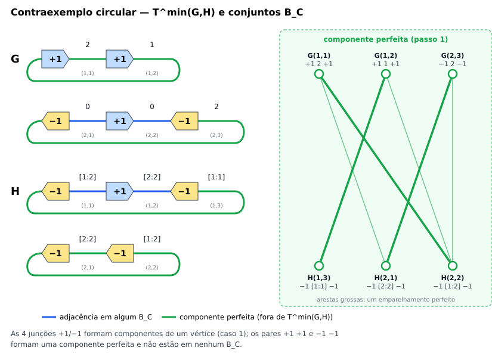
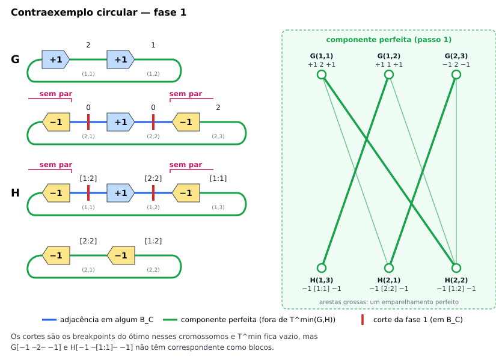
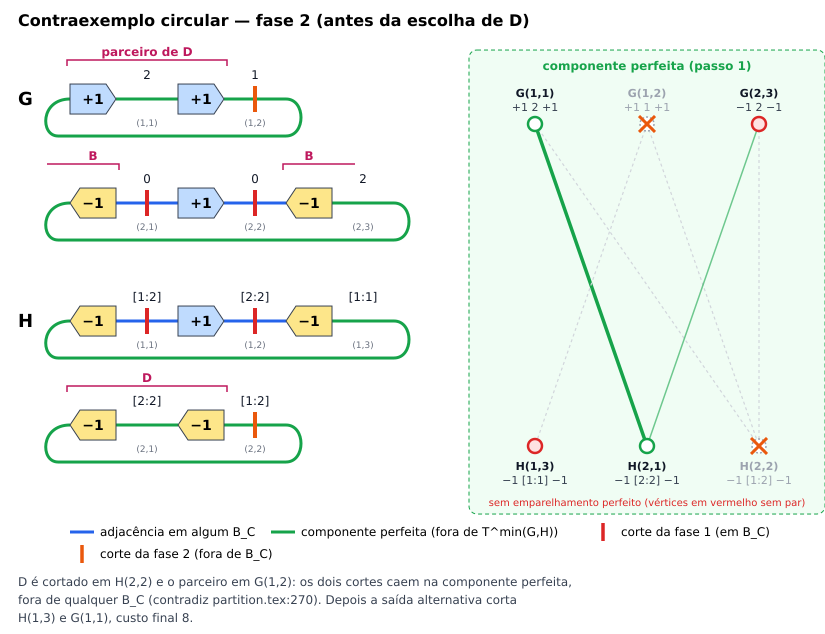
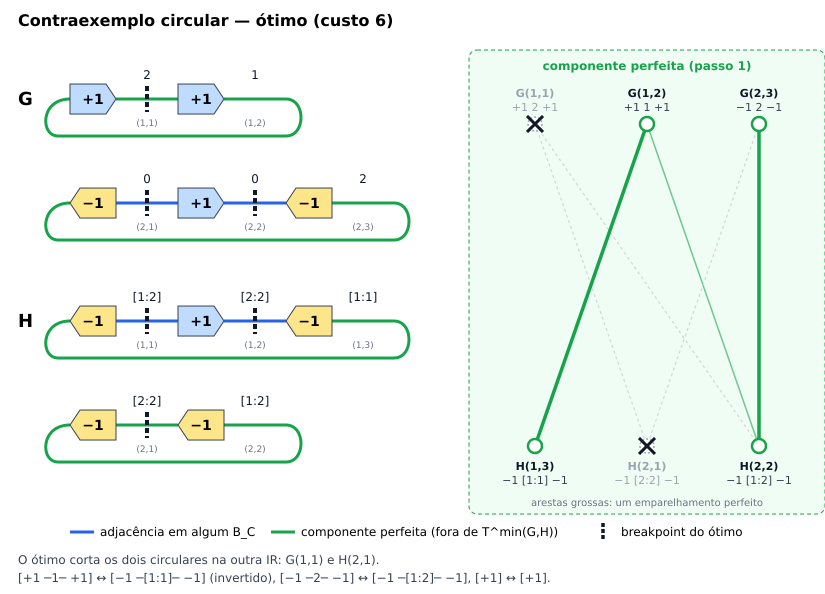
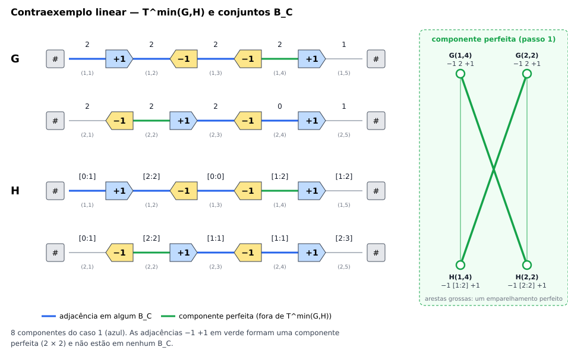
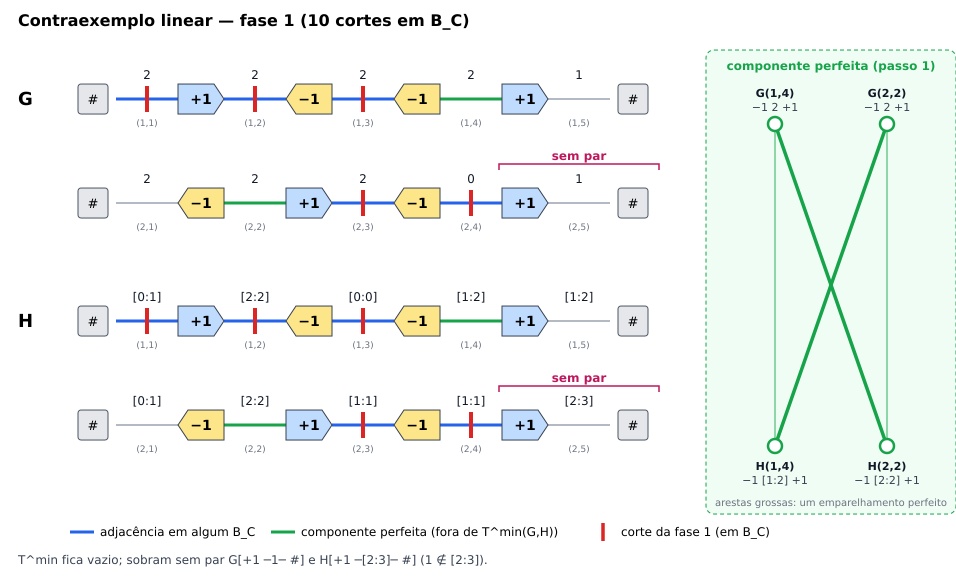
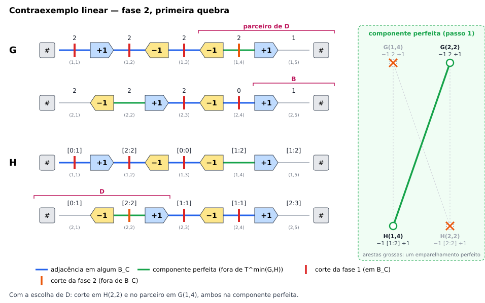
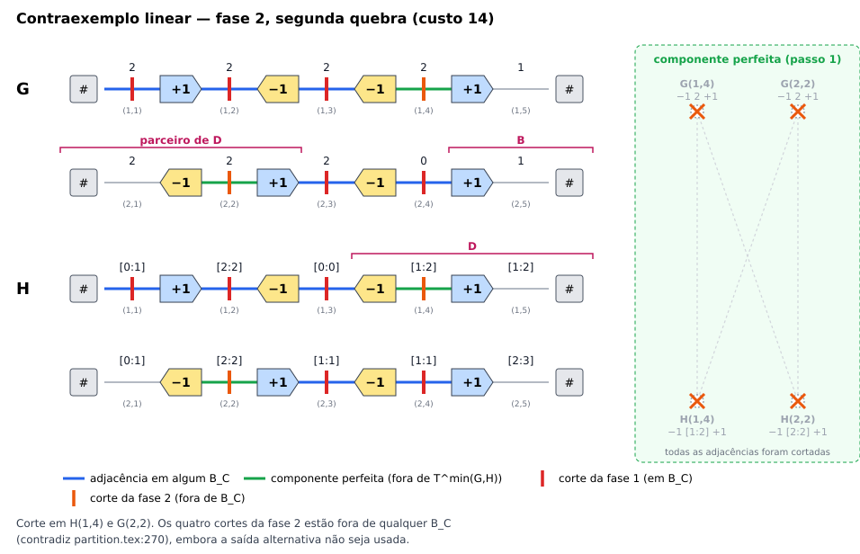
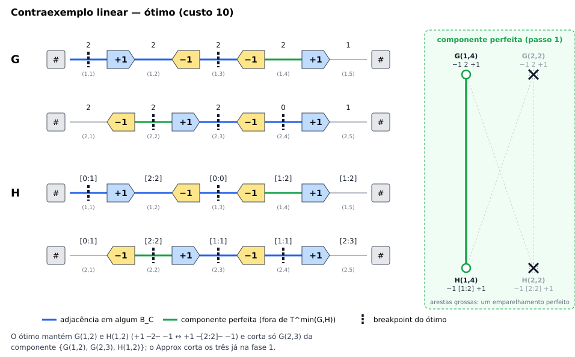
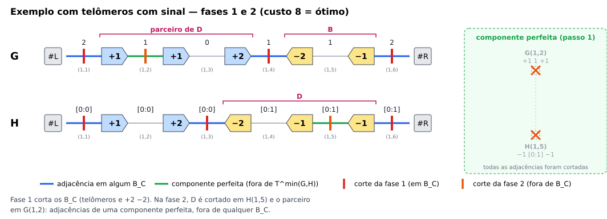

# Compatibilidade entre a implementação e o Capítulo 3 da tese

Este documento compara a árvore de trabalho atual (branch `unbalanced`, com as correções de #1–#24 do `BUGS.md`) com o Capítulo 3, "Partição de Genomas" (`tese/tese_tex/partition.tex`), e com as definições do Capítulo 2 que ele usa (`tese/tese_tex/foundation.tex`).

**Classificação de cada item**
- **Código:** a implementação diverge do que o texto especifica e deveria mudar.
- **Texto:** o texto está incompleto, impreciso ou incorreto, e o código faz o que é necessário.
- **Ambos:** é preciso decidir qual dos dois muda.
- **Extensão:** o código tem algo que o texto não menciona; não é erro, mas falta documentar.

Marcação: **[confirmado]** quando reproduzido executando o código, e **[leitura]** quando encontrado lendo o código.

**Correspondência entre algoritmos.** O Algoritmo de Correspondência de Adjacências da tese (Algoritmo 3) é o **SOARComb** (`-a SOARComb`, `soarPartition True`): o SOAR seguido de `Partition.combine`, que faz o papel da construção da partição (minimal) a partir da correspondência. O `-a SOAR` é a mesma coisa sem esse passo final.

## Em aberto (revisado em 2026-11-19)

Conferido contra a versão atual de `foundation.tex` e `partition.tex`. As linhas citadas nesta seção são as atuais; as dos itens mais abaixo podem estar desatualizadas.

### Texto da tese

1. **Lema `tmin_comp`** (`partition.tex:217-232`) [novo]. A construção dos B_C e a prova do Teorema `teo:aprox_part` usam "toda componente que intersecta C contém uma das classes de B_C". Faltam duas coisas:
   - a prova fala de um subcromossomo de C, e o enunciado da componente. É preciso dizer que a primeira e a última aresta de todos os subcromossomos de C estão nas mesmas duas classes (trocadas se a ocorrência está invertida). Então a interseção com qualquer subcromossomo contém uma delas, e ela é aresta de interseção pela definição, que inclui a classe;
   - no item 3 do enunciado, dizer que as "duas arestas" são a primeira e a última aresta de um subcromossomo de C.
2. **Circulares inteiros no grafo de compatibilidade** (item 22; `partition.tex:192,234`) [novo]. O texto define os vértices como os subcromossomos com pelo menos 2 caracteres, e assim a adjacência de fechamento de um circular sem breakpoint não aparece em nenhum vértice. O código acrescenta o próprio circular como vértice. Com esse vértice, a frase de `:234` ("se C′ ⊆ C e C′ ≠ C, então o tamanho de C′ é menor") é falsa: um circular inteiro de n genes contém subcromossomos de n genes. Isso causou um erro no código, já corrigido escolhendo C pela menor quantidade de adjacências. Conferir também a indução por tamanho do Lema `tmin_common` (`:245`), em que "todo subcromossomo da componente tem o tamanho de B, logo é um bloco inteiro" falha se um subcromossomo de n genes de um circular inteiro tiver o tamanho de B. Decidir como o texto trata circulares sem breakpoint.
3. **Regra do gene único** (item 4; `foundation.tex:87`): o texto diz que dois cromossomos de 1 gene são compatíveis se os genes são iguais. O código compara também a IR de fechamento de um circular de 1 gene.
4. **Índices e quantificadores** (item 5): na relação de intervalo (`foundation.tex:102`), trocar `P̆ᵢ^min ≤ S̆_{i+d} ≤ P̆ᵢ^max` por `P̆_{i+d}^min ≤ S̆ᵢ ≤ P̆_{i+d}^max`. Na ε (`:99`) e na de intervalo, "∀i …, d ∈ Des(S,P)" deve ser "existe d ∈ Des(S,P) tal que ∀i". No inverso (`:65-67`), N não é definido (é |S|).
5. **Conflitos do SOAR** (item 10; `partition.tex:408-415`): reescrever com índices circulares e incluir a verificação na direção H→G e o caso do circular inteiro de 2 genes.
6. **Construção da partição no SOARComb** (item 11; `partition.tex:420`): o texto descreve um pareamento arbitrário seguido da partição minimal; o código usa o `combine`. Descrever o `combine` (fases e `closeCirculars`) ou dizer que ele implementa esse passo.
7. **"Algoritmo guloso" de cobertura de vértices** (item 13; `partition.tex:420,431`): o código usa a 2-aproximação por emparelhamento maximal do Capítulo 2.
8. **Complexidade do SOARComb** (item 14; `partition.tex:441`): a construção da partição não é O(n) com o `combine`.
9. **Erro de digitação** (`foundation.tex:266`): "então o temos apenas um bloco".
9a. **FPT com genomas desbalanceados** (`partition.tex:453-561`) [novo, 2026-11-23]. O `PFpt.hs` agora implementa a Regra 2 e o conjunto D. Pontos para o texto:
   - a poda (`:497`) diz que os blocos exclusivos formados pelos genes de D "também só crescem ao longo de um ramo". O número de sequências maximais de genes de D pode diminuir: remover os genes entre duas sequências as junta num bloco só. O código conta só as sequências separadas por um gene que nunca pode ser removido (gene de aresta preta, rótulo que não é abundante no seu genoma ou que já tem todos os genes em excesso em D) e considera removidos os genes de um rótulo quando os que ainda podem ser removidos são exatamente os que faltam (no fim do ramo, D tem exatamente |occ(α,G) − occ(α,H)| genes de cada rótulo α);
   - o código põe em D, já no grafo inicial, os genes cujo rótulo não ocorre no outro genoma (a Regra 2 teria um único ramo para cada um);
   - um caminho é raro ou abundante conforme o rótulo no genoma das extremidades (U), e o código procura também os vértices isolados de H (com genomas balanceados, todo caminho ímpar é raro e basta procurar a partir de G);
   - na Regra 2, para cada u ∈ U, o ramo de remoção vem antes dos ramos de casamento;
   - a busca começa com a melhor partição do Guloso e do SOARComb como a melhor encontrada, e o custo dela já entra na poda. Sem isso, nas instâncias de 200 genes a busca muitas vezes não chegava a nenhuma folha em 10 minutos (e não devolvia partição) e as partições parciais eram piores que as do Guloso. O `MCFISP-exe` ganhou a opção `-t` (tempo limite do FPT, em segundos);
   - a subseção da implementação (`:560`, com o `\todo`) pode citar esses pontos. Ela continua certa sobre a busca em profundidade com a melhor partição e o tempo limite.

### Código

10. **Fase 2 corta também o parceiro de D** (item 16). O Algoritmo 1 só corta D. A fase 2 só roda com relações que não são simétricas e transitivas, para as quais a tese não garante fator; então isso não afeta o teorema. Decidir se o código deve seguir o pseudocódigo.
11. **`ApproxLB`** (item 23): agora devolve q, a cota da prova, que vale para genomas balanceados. Para desbalanceados, o `balancedLowerBound` só limita as partições com os exclusivos escolhidos pelo Balancer. A ajuda do `Main` não tem essa ressalva.
12. **Opcionais do SOAR** (itens 13 e 14): completar o conjunto independente até ficar maximal (nunca piora) e indexar os duos por posição para construir o grafo mais rápido.
12a. ~~**FPT não exato com circular cortado uma vez**~~ ✅ corrigido: a testemunha só considerava uma das janelas máximas num circular (#29 do `BUGS.md`).

### Decidir se entra no texto

13. **Extensões** (item 24): GreedySin, `-a SOAR` sem o `combine` (que ainda corta circulares de 1 gene e fragmenta exclusivos), fases do `combine` e regras subótimas desativadas (#25 do `BUGS.md`).
14. **Saída sem a bijeção π** (item 25).
15. ~~**Telômeros em excesso**~~ ✅ corrigido: o `Main` iguala o número de lineares com cromossomos lineares vazios, como em `foundation.tex:109` (ver a seção Balanceamento).
16. **Escolha de C no Approx** (item 20): o código pega a componente imperfeita com menos adjacências e, dentro dela, prefere o genoma com mais vértices e o vértice de maior grau. O texto deixa a escolha livre, o que é suficiente para a prova.

### Pesquisa opcional (não é necessária para a tese)

17. **Fator tk** em vez de 2tk: `ProvaTk.md` e as seções [Rumo a uma prova do fator tk](#rumo-a-uma-prova-do-fator-tk) e [Obstruções](#obstruções-com-incompatibilidades-entre-emparelhamentos). Para a igualdade, tk está provado quando os elementos de T^min têm até 3 genes, com outra construção dos B_C.
18. **Fator para relações não transitivas**, em que a fase 2 roda: a seção [Contraexemplo ao argumento do Algoritmo 1](#contraexemplo-ao-argumento-do-algoritmo-1) mostra que os cortes da fase 2 podem cair fora dos B_C. A tese agora diz que, nesse caso, não garante fator.

### Resolvidos nesta revisão

- **Item 3:** o texto agora aceita um circular com um único breakpoint (`foundation.tex:266`), restando só o erro de digitação acima.
- **Item 9:** o texto agora explica o critério de parada do Guloso (`partition.tex:368`).
- **Itens 19, 21 e 26 e o argumento de aproximação:** a tese tem um novo Algoritmo 1, com classes ativas, e uma nova prova de 2tk para relações simétricas e transitivas; o código segue essa versão (ver a atualização no item 26). A saída alternativa do `addBreaks` continua no código como proteção, mas não foi usada em nenhum teste.

---

## Resumo

| # | Tipo | Onde (tese → código) | Inconsistência |
|---|------|----------------------|----------------|
| 1 | ✅ corrigido | `foundation.tex:310` → `Partition.hs:191-198` | O custo implementado contava blocos, não breakpoints |
| 2 | ✅ corrigido | `foundation.tex:283` → `Partition.hs:236-239` | `checkCommonUnbal` ignorava os telômeros (`#`) na condição X∩Y=∅ |
| 3 | ✅ texto corrigido | `foundation.tex:261-264` → `Partition.hs:105,135` | Circular com 1 bloco e 1 breakpoint: o código aceita, a definição não |
| 4 | Ambos | `foundation.tex:83` → `Genomes.hs` (RFDM) | Regra do gene único × IR de fechamento de circular de 1 gene |
| 5 | Texto | `foundation.tex:65-68,97,100` | Índices e quantificadores da relação de intervalo/ε; `N` não definido |
| 6 | ✅ corrigido | `partition.tex:245,337,375` → `app/Main.hs` | Só o PRCMG com relação de intervalo podia ser rodado (sem PDCMG) |
| 7 | ✅ corrigido | `partition.tex:355` → `PGreedy.hs` (`commonPrefixC`) | O Guloso fixava a orientação pelo 1º gene e perdia blocos reversos |
| 8 | ✅ corrigido | `partition.tex:355` → `LocalBase.hs:105`, `PGreedy.hs` | Empate no Guloso ignorava o fechamento de circulares |
| 9 | ✅ texto corrigido | `partition.tex:339,353` → `PGreedy.hs:46-48` | Critério de parada do Guloso |
| 10 | Texto | `partition.tex:379-389` → `PSOAR.hs:69-79` | As condições de conflito do texto não bastam (circulares; direção H→G) |
| 11 | Ambos (código ✅) | `partition.tex:391,410` → `PSOAR.hs:124-139`, `Partition.hs` (`combine`) | A partição do SOARComb não é obtida a partir de uma correspondência; o `combine` deixava circulares cortados (corrigido) |
| 12 | ✅ corrigido | `partition.tex:391` → `PSOAR.hs` (`getBpsFromIS`), `combine` | SOARComb fragmentava os blocos exclusivos (entrada desbalanceada) |
| 13 | Texto | `partition.tex:391,402` → `PSOAR.hs:116-122` | "Algoritmo guloso" de cobertura é a 2-aproximação por emparelhamento maximal |
| 14 | Ambos | `partition.tex:412` → `PSOAR.hs:98`, `Partition.hs` (`combine`) | A complexidade do SOARComb é maior que O(n³p) |
| 15 | ✅ corrigido | `partition.tex:238-240,272` → `PApprox.hs:330,377-389` | `B_C` era guardado como pares de rótulos sem sinal: a cota \|B_C\| ≤ tk não valia |
| 16 | Código | `partition.tex:248-251,313-315` → `PApprox.hs:463-480` | Fase 2 do Approx também corta o bloco parceiro (fora de qualquer `B_C`) |
| 17 | ✅ corrigido | `partition.tex:251` → `PApprox.hs:416-431` | Fase 2 não voltava ao laço de `T^min` após cada quebra |
| 18 | ✅ corrigido | `partition.tex:248,312` → `PApprox.hs:420-449`, `Partition.hs:250-262` | B não era "o maior bloco sem correspondente" |
| 19 | ✅ resolvido (nova prova) | `partition.tex:266` → `PApprox.hs:163,226,453` | Terminação: o código abortava em casos que a prova diz impossíveis (um deles ocorre e agora tem saída) |
| 20 | Extensão | `partition.tex:305-307` → `PApprox.hs:190-228` | Escolha de X e do breakpoint (união dos `B_C`) |
| 21 | Obsoleto (novo algoritmo) | `partition.tex:223-224,240` → `PApprox.hs:337,362-399` | Classificação entre caso 2 e caso 3, e cobertura do caso 3 |
| 22 | Extensão | `partition.tex:194` → `PApprox.hs:96-140` | Vértices de cromossomos circulares no grafo de compatibilidade |
| 23 | Extensão | — → `Balancer.hs:169-184`, `PApprox.hs` (`approxLowerBound`), `Main` | `ApproxLB`: agora é a cota q da prova; inválido no caso desbalanceado |
| 24 | Extensão | — → `PGreedy.hs`, `PSOAR.hs`, `Partition.combine` | GreedySin, SOAR sem `combine`, regras subótimas e as fases do `combine` não aparecem no texto |
| 25 | Extensão | `foundation.tex:282,308` → `Partition.hs:333-343`, `Main` | A saída lista os blocos compatíveis candidatos, não a bijeção π |
| 26 | Obsoleto (novo algoritmo) | `partition.tex:215-243` → `PApprox.hs` (`checkIntersections`) | Construção dos B_C: o caso 3 não era uma 2-aproximação da cobertura de vértices de G, e o caso 2 usava só interseções posicionais |

---

## Definições (Capítulo 2, usadas no Capítulo 3)

### 1. O custo conta blocos, não breakpoints — Ambos [leitura] — ✅ corrigido

> O custo agora segue o texto. `numBreakpoints` (`Partition.hs`) conta, para cada partição, os blocos menos um por cromossomo linear e menos os circulares inteiros. `costBalanced` e `costUnbalanced` devolvem a soma dos breakpoints de G e de H.
>
> Mudanças no FPT:
> - A poda (`toBig`) usa o limitante 2·|amostra| − (#cromossomos de G + #cromossomos de H). Cada testemunha é pelo menos um bloco em cada lado. Sem circulares, a poda é a mesma de antes.
> - O melhor custo é guardado junto com o melhor grafo de amostra, para não ser recalculado a cada poda.
>
> A poda mais fraca com circulares expôs um bug antigo em `cleanEdges`, corrigido junto (#27 do `BUGS.md`).
>
> Verificação: `stack test` passou 5 vezes. Em 150 instâncias balanceadas (com e sem `-c`, com repetições), o FPT nunca teve mais breakpoints que Greedy, SOARComb ou Approx. Totais: FPT 2212, SOARComb 2212, Greedy 2218, Approx 2266.

- **Tese** (`foundation.tex:310`): "O custo de uma partição comum … é o número de breakpoints de ambas as partições".
- **Código** (`Partition.hs:191-198`): `costBalanced` e `costUnbalanced` devolvem `length bs`, o número de **blocos**. Os comentários dizem "number of breakpoints". É o objetivo minimizado pelo FPT (`PFpt.hs:183`).
- **Diferença:**
  - Pela definição, #breakpoints = #blocos − #lineares − #circulares inteiros.
  - **Caso balanceado:** minimizar blocos não distingue um circular inteiro (0 breakpoints) de um circular cortado uma vez (1 breakpoint).
  - **Caso desbalanceado:** `costUnbalanced` = comuns + exclusivos_G + exclusivos_H, e a definição dá 2·comuns + exclusivos_G + exclusivos_H − constantes. Os blocos exclusivos ficam com peso relativo dobrado. Na época esse ramo não era usado, porque o FPT recusava entradas desbalanceadas (ele as aceita desde 2026-11-23, ver o item 9a do "Em aberto").
- **Ação:** fazer o custo contar `breakpoints` de G e de H, ou definir no texto o custo em blocos e ajustar o Teorema `teo:emp_part_cost`.

### 2. `checkCommonUnbal` ignora os telômeros na condição X∩Y=∅ — Código [confirmado] — ✅ corrigido

> `checkCommonUnbal` não remove mais os caps: o telômero é um rótulo como os outros e só pode aparecer em blocos exclusivos do genoma onde é abundante, isto é, o que tem mais cromossomos lineares. A partição do exemplo abaixo agora é rejeitada, e G `0 | 1 | 3 0` × H `0 | 2 | 3 0` continua aceita.
>
> Nada quebrou:
> - `stack test` passou 5 vezes. Os pares desbalanceados do gerador de testes passam por DCJs, que mudam o número de lineares.
> - 950 execuções em instâncias do `DB-exe` (desbalanceadas e balanceadas, com `-c`) não tiveram nenhum crash nem saída inválida.
> - 780 execuções em 180 instâncias geradas com cromossomos divididos de formas diferentes em G e H (121 delas com números diferentes de lineares) também não tiveram nenhum crash nem saída inválida. Foram rodados SOAR, SOARComb, Greedy, GreedySin e Approx, e o validador independente também conferiu o telômero.
>
> Isso já era esperado: blocos unitários de telômero sempre casam, então nenhum algoritmo deixava telômeros sem par nos dois genomas. Só o verificador era mais fraco que a definição.

- **Tese** (`foundation.tex:283`, condição 4): "X ∩ Y = ∅". `#` é um rótulo (`foundation.tex:32,48`: "O rótulo # é abundante em G").
- **Código** (`Partition.hs:236-239`): `withoutCaps` remove os caps (`0`) dos dois conjuntos antes do teste. Essa remoção foi incluída na correção do bug #1.
- **Evidência:**
  - Entrada: G `L 1 3` (IRs `5 6 7`) × H `L 2 3` (`8:8 6:6 7:7`).
  - Partição testada: G `0 1 | 3 0`, H `0 2 | 3 0`.
  - `checkCommonUnbal` aceita, mas os blocos exclusivos `0 1` e `0 2` compartilham `#`, que é raro nos dois genomas. Pela tese a partição é inválida: o custo mínimo válido é 4, e o verificador aceita uma de custo 2.
  - Os algoritmos não geraram esse caso nos testes. Só o verificador é mais fraco que a definição.
- **Ação:** testar também os caps, contando quantos estão em excesso, em vez de removê-los. Se a remoção foi intencional (telômeros são "baratos"), documentar isso no texto.

### 3. Circular com 1 bloco e 1 breakpoint — Texto [confirmado] — ✅ texto corrigido

> O texto agora aceita esse caso (`foundation.tex:266`).

- **Tese** (`foundation.tex:261-264`): num circular, |𝒫| = 1 implica 𝒫₁ = C, sem breakpoint, e |𝒫| > 1 implica |𝒫| breakpoints. Não existe 1 bloco com 1 breakpoint.
- **Código** (`Partition.hs:105`, `mkPartitionFromBlocks` em `:135`): com um único breakpoint `k`, o bloco é o circular linearizado de `next(k)` até `k`. Todos os algoritmos produzem esse caso:
  - G `C 1 2 3` × H `L 1 2 3` dá G `C 1 2 3 ; 1 2 | 3`;
  - G `C 6 ; 27` × H `C 6 ; 39:57` dá `C 6 ; | 27`.

  Pela definição, o primeiro exigiria pelo menos 2 blocos em G.
- **Ação:** permitir no texto o caso |𝒫| = 1 com um breakpoint (o circular linearizado). O código é o modelo mais geral, e a figura `fig:partition` não cobre o caso.

### 4. Regra do gene único × IR de fechamento — Ambos [leitura]

- **Tese** (`foundation.tex:83`): "caso C e C' tenham apenas um gene S = S' é suficiente para estabelecer C ≈_C C'".
- **Código** (`Genomes.hs`, RFDM): num circular de 1 gene, compara também a IR de fechamento. As correções #20 (FPT, `closesCircle`) e o caso de circular inteiro do Guloso seguem o mesmo critério.
- **Diferença:** pela leitura literal, `C 6 (27)` ≈ `C 6 (39:57)` com custo 0. O código põe 1 breakpoint.
- **Ação:** restringir no texto a regra a subcromossomos de 1 gene sem IR (os lineares), ou fazer o código ignorar a IR de um circular de 1 gene.

### 5. Índices e quantificadores das relações — Texto [leitura]

- **Relação de intervalo** (`foundation.tex:100`): "P̆ᵢ^min ≤ S̆_{i+d} ≤ P̆ᵢ^max". Mas `Des(S,P)` (`:8`) é definido por `Sᵢ = P_{i+d}`, então o correto é `P̆_{i+d}^min ≤ S̆ᵢ ≤ P̆_{i+d}^max`, como já está na relação ε (`:97`).
- **Quantificador** (`:97,100`): "∀i …, d ∈ Des(S,P)" deve ser "existe d ∈ Des(S,P) tal que ∀i". O código (`matchAt (rot k …)` com `any k`) usa a leitura correta, com o mesmo deslocamento para genes e IRs.
- **Inverso** (`:65-68`): `N` não é definido; deve ser |S|. A semântica, com a IR de fechamento mantida no fim, bate com `intergenicFullReversal`.

---

## Executável (`app/Main.hs`)

### 6. Só o PRCMG com relação de intervalo pode ser rodado — Código [leitura] — ✅ corrigido

> Nova opção `--direct` (`-d`) no `MCFISP-exe`: todos os algoritmos (inclusive FPT e ApproxLB) passam a usar `RFDM`, ou seja, compatibilidade completa e partição direta comum (PDCMG). Sem a opção continua `RFRM` (PRCMG). `produceBlockMatch` e `getPartition` agora recebem o matcher.
>
> Ajustes necessários:
> - **Sinais incompatíveis.** Com `-s --direct`, se um rótulo tem mais cópias positivas num genoma e mais cópias negativas no outro, não existe partição direta comum: a tese já observa que isso só é garantido quando os sinais coincidem (`foundation.tex:310`). O `Main` detecta o caso (`directPossible`) e escreve uma mensagem clara, em vez do `logicError` dos algoritmos.
> - **Balanceamento por gene com sinal.** O Balancer (usado pelo Approx e pelo ApproxLB) contava o excedente pelo rótulo sem sinal. Numa partição direta com sinais, isso podia remover a cópia de sinal errado (por exemplo, o `-3` em vez do `+3`) e deixar genomas sem partição direta, e o Approx terminava em `logicError`. A classe `Matcher` ganhou o método `allowsReverse`, e o Balancer conta o excedente pelo gene com sinal quando o matcher é direto (`geneKey`/`occBalanceBy`/`balanceGenomes`). Para genomas sem sinal nada muda.
>
> Testes novos:
> - `prop_*DirectMultiPartitionIsValid` (Greedy, GreedySin, SOAR, SOARComb e Approx com `RFDM`, genomas sem sinal, balanceados ou não, 300 testes cada);
> - `prop_fptDirectIsValidAndNotWorseThanOthers`: o FPT direto é válido e nunca é pior que os outros.
>
> Verificação:
> - `stack test` passou 5 vezes (39 propriedades).
> - No executável, 180 instâncias foram rodadas com e sem `--direct`. As únicas falhas foram a mensagem de "não existe partição direta comum" nas instâncias com sinais incompatíveis. O FPT direto nunca foi pior que os outros algoritmos diretos (45 instâncias).
>
> Observação: o FPT reverso **sem sinal** continua não suportado, como diz o cabeçalho do módulo. Desde a correção do #22 ele ramifica nos dois sentidos para todo gene, e pode ser muito lento (131 s numa instância de 13 genes que o FPT direto resolve em 1 s).

- **Tese** (`partition.tex:245,337,339,375,391`, `foundation.tex:312-322`): todos os algoritmos servem ao PDCMG (compatibilidade completa, genomas sem sinais) e ao PRCMG, com qualquer relação de compatibilidade.
- **Código:** `getPartition` usa sempre `RFRM` (intervalo, compatibilidade parcial, G rígido e H flexível). `RFDM`/`RRDM` existem e os algoritmos são genéricos no `Matcher`, mas não há opção de linha de comando.
  - As relações trivial, de igualdade e ε só são obtidas montando intervalos na entrada. A igualdade sai de H rígido, lido com `flexibilizeMC 0`.
  - Com `-s` roda PRCMG com sinais (fator 2k no Approx); sem `-s`, PRCMG sem sinais (4k).
- **Ação:** acrescentar uma opção (por exemplo, `--direct`) que use `RFDM`, ou dizer no texto que o executável resolve só o PRCMG.

---

## Balanceamento (`partition.tex:170-188`)

Consistente. Detalhes que o texto deixa em aberto:

- `markExclusive` escolhe a maior sequência de caracteres disponíveis, desempatando pela mais à esquerda, e permite sequências que atravessam a origem de circulares.
- Processa todo G antes de H. Isso dá o mesmo resultado que alternar por tamanho, porque os rótulos abundantes em G e em H são disjuntos.
- Os telômeros entram na contagem (`occBalance`). ✅ **Corrigido (2026-11-19):** antes, com números diferentes de lineares, os caps em excesso viravam blocos exclusivos, enquanto a tese acrescenta cromossomos lineares vazios (`foundation.tex:109`). Agora o `Main` chama `equalizeLinear` (`Genomes.hs`) logo depois de ler a instância: o genoma com menos lineares recebe cromossomos `L` vazios, só com os dois telômeros e uma região intergênica 0 (`0:0` em H). Isso vale para todos os algoritmos, e os telômeros ficam sempre balanceados, então o Balancer não remove mais caps. Os cromossomos vazios aparecem na saída (por exemplo, `L 0 | 0` quando são cortados) e contam no custo, como na definição. Em G `L 1 2 ; L 3` × H `L 1 2 3` (`-s`), todos os algoritmos dão custo 4 (antes o Approx dava 5 e os outros 3, em outro modelo). Verificação: 300 instâncias com sinal em que G e H dividem os mesmos genes em números diferentes de lineares (217 com números diferentes, algumas com um linear vazio na entrada): nenhuma falha, o FPT nunca foi pior que os outros algoritmos e o `ApproxLB` nunca passou do FPT. `stack test` passou.
- Veja também o item 23 (`ApproxLB`) e o #26 do `BUGS.md` (caps em excesso dão uma escolha subótima).

---

## Algoritmo de aproximação (`partition.tex:190-327`, `PApprox.hs`)

### 15. `B_C` é guardado como pares de rótulos sem sinal — Código [leitura] — ✅ corrigido

> `B_C` agora segue a definição do texto: são as adjacências da componente conexa da aresta escolhida no grafo de compatibilidade de blocos das partições iniciais.
> - A adjacência é o vértice de tamanho 2, ou o próprio cromossomo no caso de um circular de 1 gene (`adjVertexAt`). Assim o sinal, a orientação e as IRs entram pela própria compatibilidade.
> - `checkIntersections` escolhe cada `B_C` pelo identificador dessa componente (`bAt`) e devolve as posições das adjacências `(genoma, cromossomo, índice)` (`adjsOfComp`). O tipo `BreakSet` substituiu `Set (Gene, Gene)`.
> - `addBreaks` testa a posição exata da adjacência. Se o X escolhido não tiver adjacência em nenhum `B_C`, tenta o próximo candidato em vez de abortar.
> - `findBreakpoint` registra as posições dos cortes que faz.
> - O limitante (`ApproxLB`) conta os `B_C` escolhidos, uma vez por componente.
>
> Verificação, com `-s` e sem sinal, com e sem `--direct`, em instâncias balanceadas e desbalanceadas do `DB-exe` e do gerador com cromossomos divididos de formas diferentes (430 execuções do Approx):
> - Os 4918 conjuntos `B_C` escolhidos têm no máximo k adjacências em cada genoma (≤ 2k no total), como a prova usa.
> - O primeiro candidato X sempre teve uma adjacência em algum `B_C` (a alternativa nunca foi usada).
> - Nenhuma falha e nenhuma saída inválida.
> - O Approx ficou melhor que antes em 51 execuções e nunca pior (5934 contra 6044 breakpoints).
> - O `ApproxLB` continua um limitante válido (nunca acima do ótimo do FPT em 125 instâncias balanceadas) e ficou bem mais justo: soma 1604, contra 1262 antes e ótimo de 1628.
>
> `stack test` passou 3 vezes.

- **Tese** (`partition.tex:238-240`): "o conjunto B_C é formado pelas arestas da componente conexa de e". `:272-273`: |B_C| ≤ tk, com t = 2 (com sinais ou compatibilidade completa) e t = 4 (sem sinais, parcial).
- **Código** (`PApprox.hs:330,377-389`; uso em `:226-228`): `breakSet :: Set (Gene, Gene)` guarda pares de rótulos com `canonicOri`, sem sinal, e `testIR` aceita também `(b, a)`. Qualquer adjacência com esses rótulos vira candidata, mesmo com outro sinal ou com IR incompatível com a componente.
- **Diferença:** com sinais, a cota |B_C| ≤ 2k usada na prova não é garantida pela estrutura: chega a cerca de 4k.
- **Ação:** guardar as adjacências (posições) da componente, ou pares com sinal e orientação.

### 16. A fase 2 corta também o bloco parceiro — Código [leitura]

- **Tese** (`partition.tex:248-251`; Alg. 1, `:313-315`): "Adicione breakpoints em D ao redor do subcromossomo". A prova (`:270`) supõe que todos os breakpoints adicionados estão em algum `B_C`.
- **Código** (`PApprox.hs:463-480`, `findBreakpoint`): corta D (`cuts2`) e **também** um bloco `b1` da outra partição que casa com D, nas posições alinhadas (`cuts1`).
- **Diferença:** os cortes em `b1` não estão necessariamente em nenhum `B_C`, e a análise L ≤ tk·L\* não os cobre.
- **Ação:** remover os cortes em `b1`, ou incluí-los no texto e na prova.

### 17. A fase 2 não volta ao laço de `T^min` — Código [leitura] — ✅ corrigido

> `compatibilityCompletion` agora quebra **um** bloco D por chamada e devolve o controle ao laço externo de `approxPartition`. O laço reconstrói o grafo de compatibilidade e esvazia `T^min` (fase 1) antes da próxima quebra, como em `:251` e no Algoritmo 1.

- **Tese** (`partition.tex:251`; Alg. 1, `:303-317`): "Repita o processo anterior caso T^min deixe de ser vazio". Depois de cada D, o algoritmo volta ao laço interno.
- **Código** (`PApprox.hs:416-431`): `breakBlock` se chama recursivamente até não haver blocos sem par, sem testar `T^min` entre as quebras. Só volta à fase 1 (`loop`, `:158-170`) quando `findBreakpoint` devolve `Nothing`.

### 18. B não é "o maior bloco sem correspondente" — Código [leitura] — ✅ corrigido

> B agora é o maior bloco sem par num emparelhamento máximo (`getBlocksFit`, exportado por `Partition`), considerando G e H juntos (empate: G). D é procurado primeiro para B. Os blocos do caminho alternante de `findUncommon` (do mesmo genoma de B) só são usados se B não levar a nenhum D. A partição é comum exatamente quando não há blocos sem par, porque os genomas da entrada do Approx são balanceados.
>
> Verificação dos itens 17 e 18:
> - A fase 2 é rara: não foi usada em nenhuma das 590 instâncias do `DB-exe` (incluindo 160 com 40–50 genes) e apareceu em 65 de 18000 instâncias pequenas geradas com circulares e alfabeto de 1 a 3 genes.
> - Nessas 65 o custo foi igual ao da versão anterior, e as saídas são válidas.
> - Em todas as 18000 não houve falha; nas 590 do `DB-exe`, custo e tempo não mudaram.
> - `stack test` passou 3 vezes.

- **Tese** (`partition.tex:248,312`): "maior bloco em Pa ou Pb sem correspondente".
- **Código:**
  - `PApprox.hs:420-431` procura primeiro em G e só depois em H.
  - `findUncommon` (`Partition.hs:250-262`) percorre os blocos em ordem decrescente de tamanho e devolve o primeiro em que a busca de caminho aumentante falha, junto com os blocos do caminho. Não é necessariamente o maior bloco sem par, e um bloco maior de H nunca tem precedência.
  - `findBreakpoint` (`:442-449`) usa o **primeiro** par `(b2, u)` encontrado entre esses blocos.

### 19. Terminação — Ambos [leitura] — ✅ resolvido

> A nova prova (Lema `tmin_ativa`) mostra que o algoritmo sempre encontra uma aresta para cortar. A saída alternativa ficou no código como proteção e não foi usada em nenhum teste desde que C passou a ser escolhida pela menor quantidade de adjacências.

- **Tese** (`partition.tex:266`): "o algoritmo termina e gera uma partição comum". A garantia vem de que, sem adjacências internas, todos os blocos são unitários.
- **Código:** termina com erro em vez de seguir até os blocos unitários:
  - `PApprox.hs:163`: `logicError` se uma iteração não progride (correção do #6);
  - `:226`: `patternError` se o vértice escolhido não tem par em `breakSet`;
  - `:453`: `logicError` se não existe `b1`.

  Nenhum desses erros foi disparado nas revisões (milhares de instâncias), mas a prova não justifica que eles sejam impossíveis com as escolhas concretas do código (itens 15–18).
- **Ação:** um fallback que corta uma adjacência interna qualquer, ou um argumento no texto de que esses casos não ocorrem.
- **Atualização:** o caso de `PApprox.hs:226` (nenhum candidato X com adjacência em algum `B_C`) **ocorre**. Ele já ocorria antes do item 15, e o código agora tem uma saída para ele. Os outros dois erros (`:163`, `:453`) não ocorreram em nenhum teste. O contraexemplo está detalhado na seção [Contraexemplo ao argumento do Algoritmo 1](#contraexemplo-ao-argumento-do-algoritmo-1).

### 20. Escolha de X e do breakpoint — Extensão [leitura]

- **Tese** (Alg. 1, `:305-307`): X é qualquer subcromossomo de uma componente de `T^min`, e b é um breakpoint em `B_C` dessa componente.
- **Código** (`PApprox.hs:190-228`):
  - X é escolhido entre os vértices de menor tamanho das componentes não perfeitas, com prioridade ao genoma com mais vértices e desempate por grau (`sortKey`). Se X não tiver adjacência em nenhum `B_C`, passa-se ao próximo candidato (isso nunca ocorreu nos testes).
  - b é a primeira adjacência de X que está na **união** de todos os `B_C` (desde o item 15, como posições exatas), e não necessariamente no da componente de X. A prova só exige "em algum `B_C`", então o argumento continua válido, mas o pseudocódigo difere.

### 21. Casos 2 e 3 do Lema `tmin_comp` — Extensão [leitura] — obsoleto

> Descreve o código anterior. Ver a atualização no item 26.

- **Tese** (`:223-224,240`): o caso 2 tem uma aresta de interseção comum a todas as componentes que intersectam. O caso 3 constrói um grafo G (um vértice por aresta de interseção, uma aresta por componente) e usa uma cobertura de vértices 2-aproximada.
- **Código:**
  - Classificação (`PApprox.hs:362-374`): usa a menor interseção à esquerda (`l`) e à direita (`r`) entre os vértices da componente, com a orientação ajustada (`updateEntry`). É caso 2 se há interseção de um só lado ou se `l-1 > vSize-r`.
  - Breakpoint do caso 2: `l-2` ou `vSize-r` (`:380-385`).
  - Caso 3 (`:391-399`): pega uma componente não coberta, corta as duas extremidades do representante (offsets 0 e `vSize-2`) e remove as componentes que a intersectam. É a 2-aproximação por emparelhamento maximal, com as arestas candidatas sendo sempre as extremidades, o que é coerente com `:233`.
  - Componentes do caso 3 já cobertas pelas escolhas do caso 2 são retiradas antes da cobertura (`remaining_cases_iii`, `:337`), o que o texto não descreve.

### 22. Circulares no grafo de compatibilidade — Extensão [leitura]

- **Tese** (`partition.tex:194`): vértices são "todos os subcromossomos de tamanho pelo menos 2 em blocos". A seção não discute circulares.
- **Código** (`PApprox.hs:126-140`, `partVertices`): para um bloco que é um circular inteiro, os vértices são:
  - o próprio cromossomo (`vWhole`), mesmo com 1 gene;
  - os subcromossomos de tamanho 2..n a partir de cada posição, dando a volta;
  - os de tamanho n sem a adjacência de fechamento.

  `contains` e `rightOverlap` (`:96-114`) tratam `vWhole` à parte.

### Complexidade

A complexidade é polinomial, como afirmado (`:287`). O grafo é reconstruído a cada breakpoint, e `vertexPairsNotPerfs` percorre O(n⁴) pares de vértices, o que dá algo como O(n⁵)–O(n⁶) no total. O texto não fixa um expoente, então não há inconsistência.

---

### 26. Construção dos conjuntos B_C — Código [confirmado] — obsoleto (novo algoritmo)

> **Atualização (2026-11-19), algoritmo com classes ativas.** O `PApprox` agora segue o Algoritmo 1 e o Teorema `teo:aprox_part` da versão atual da tese. `mkClasses` substituiu `checkIntersections`: calcula as classes de G_0 e um B_C por componente de T^min(G,H) (caso 1: uma classe; caso 2: uma aresta de interseção comum; caso 3: as classes da primeira e da última aresta), sem cobertura de vértices. `addBreaks` corta numa classe ativa se C tiver uma; senão ativa as classes de B_C. A fase 2 ativa as classes dos cortes que faz. `approxLowerBound` devolve o número de ativações. Além disso, C passou a ser escolhida pela menor quantidade de **adjacências**, e não de genes: um circular inteiro com n genes contém subcromossomos com n genes e não está em T^min, e antes isso fazia o código usar a saída alternativa. Verificação: 1800 instâncias pequenas com o ótimo do FPT (lineares e circulares, com e sem sinal, igualdade e intervalo): a cota nunca passou do ótimo, o custo nunca passou de 2tk vezes a cota, e a saída alternativa nunca foi usada.

> **Correção** (`checkIntersections`):
> - **Caso 2**, pela definição estendida. `case2Cands c` é a interseção, sobre as componentes D que intersectam C, das componentes de adjacência das arestas comuns entre C e D (`sharedMap`), restrita às arestas de C. Se não for vazia, C é do caso 2. O B_C é um desses candidatos: um B_C já escolhido (casos 1 ou 2), se algum servir; senão a aresta posicional de antes, se estiver entre os candidatos; senão o menor candidato.
> - **Caso 3**, pela 2-aproximação do texto. G tem como vértices as componentes de adjacência da primeira e da última aresta de cada componente do caso 3, e cada componente é uma aresta. O emparelhamento maximal escolhe uma aresta ainda descoberta, acrescenta as duas pontas, e com isso cobre todas as arestas que tocam essas pontas. Pontas já escolhidas nos casos 1 e 2 contam como cobertas, o que só reduz breakpoints.
> - O limitante (`ApproxLB`) conta os B_C dos casos 1 e 2 e o tamanho do emparelhamento do caso 3 (≤ cobertura mínima q).
>
> **Verificação.** A reimplementação independente das definições do texto foi aplicada às mesmas 30300 instâncias:
> - componentes do caso 2 tratadas como caso 3: 0 (antes 141);
> - componentes do caso 2 sem B_C adequado: 0;
> - componentes do caso 3 não cobertas: 0;
> - coberturas acima de 2× a mínima: 0 (antes 4);
> - emparelhamentos maiores que a cobertura mínima: 0.
>
> **Efeito no Approx**, nas 256 instâncias em que a classificação muda:
> - nenhuma falha, e todas as saídas são válidas;
> - custo 2181 contra 2179 antes (melhor em 2, pior em 3, por 2 breakpoints cada). As escolhas de B_C mudam, e o algoritmo continua heurístico dentro da garantia;
> - o `ApproxLB` continua válido (0 violações contra o ótimo do FPT em 252 instâncias), mas ficou mais fraco: 1217 contra 1340, com ótimo de 1778. Isso acontece porque o caso 2 reaproveita B_C e o caso 3 conta o emparelhamento, e não B_C/2.
>
> `stack test` passou 3 vezes. O ponto (c), os cortes da fase 2 entre os candidatos, continua em aberto.

Esta é uma verificação dirigida da construção dos B_C (`partition.tex:215-243`) contra `checkIntersections`/`addBreaks_i/ii/iii` (`PApprox.hs`). Uma cópia instrumentada do código calculou, ao lado das escolhas do código, as definições do texto: aresta de interseção, que inclui as arestas das componentes conexas das arestas comuns; casos 2 e 3 do Lema `tmin_comp`; e o grafo G do caso 3 com cobertura mínima por força bruta. Foram usadas 30300 instâncias balanceadas com sinal: as do `DB-exe` (`rep_s`, `rand_s`, `big_s`, `big_r`), as geradas com cromossomos divididos de formas diferentes, e as 30000 pequenas (18000 só com circulares e 12000 só com lineares).

**O que está de acordo com o texto**
- **T^min:** componentes sem emparelhamento perfeito que não contêm propriamente um subcromossomo de outra (`selectTmin`/`contains`). Pelo Lema `gcomp_sub`, testar um representante basta, e o código testa todos.
- **Quando os B_C são calculados:** uma vez, sobre T^min(G,H) com cada cromossomo como um bloco, como no texto. A entrada do Approx são os genomas já balanceados pelo Balancer, como pede o Algoritmo 1.
- **Elementos de B_C:** desde o item 15, B_C são as arestas de adjacência da componente conexa da aresta escolhida, vista como vértice do grafo de compatibilidade.
- **Caso 1:** uma aresta qualquer do representante (offset 0).
- **Caso 2:** quando o código classifica uma componente como caso 2, a aresta escolhida (comum a todas as interseções, no representante) é de fato uma aresta de interseção com respeito a todas as componentes que a intersectam. Isso nunca falhou.
- **Caso 2 compartilhado:** o código não escolhe um B_C próprio para componentes do caso 2 que intersectam uma já atendida. Mesmo assim, em todas as instâncias, cada componente do caso 2 teve entre os B_C escolhidos uma aresta de interseção com respeito a todas as componentes que a intersectam. O efeito é o mesmo de escolher um B_C para cada uma.
- **Caso 3 (cobertura):** em todas as instâncias, toda componente do caso 3 do texto teve a primeira ou a última aresta (as duas arestas do lema, `:233`) num B_C escolhido. Ou seja, a escolha é uma **cobertura** de vértices de G.
- **Componentes novas de T^min** (`:243`): o código procura a adjacência na união de todos os B_C, o que corresponde a "algum B_C′".

**Divergências**

**(a) O caso 3 não é uma 2-aproximação da cobertura mínima de G.** O texto (`:240`, e a prova em `:282`) usa o algoritmo com fator 2 para a cobertura de vértices. Esse algoritmo escolhe uma aresta de G ainda não coberta, põe as duas pontas na cobertura e marca como cobertas todas as arestas **que tocam essas pontas**. O código (`addBreaks_iii`) põe as duas pontas (a primeira e a última aresta do representante), mas marca como cobertas só as componentes que **intersectam por posição** a componente escolhida. Duas componentes podem não se intersectar por posição e ainda ter uma ponta em comum em G (a mesma componente de adjacência). Então as componentes escolhidas não formam um emparelhamento em G, e a cobertura pode passar de 2× a mínima.

- Ocorrências: em 4 das 213 instâncias com caso 3, o código escolheu 3 B_C onde a cobertura mínima de G tem 1. Em 18 delas, duas componentes escolhidas compartilhavam uma ponta.
- Exemplo (`-s`):
  ```
  C 1 -1 1 -1 ;
  0 0 1 1 ;
  C 1 -1 ; C 1 -1 ;
  0:1 1:2 ; 0:0 0:0 ;
  ```
  - G é o circular `+1 ─0─ −1 ─0─ +1 ─1─ −1 ─1─`. T^min tem os quatro subcromossomos de 3 genes de G (cada um em sua componente, todos do caso 3) e os dois circulares de H (caso 1).
  - As adjacências formam três componentes:
    - α = {`+1 −1`: G(1,1) com IR 0, G(1,3) com IR 1, H(1,1) com [0:1] e H(2,1) com [0:0]};
    - β = {G(1,4) `−1 ─1─ +1`, H(1,2) `−1 ─[1:2]─ +1`};
    - γ = {G(1,2) `−1 ─0─ +1`, H(2,2) `−1 ─[0:0]─ +1`}.
  - As arestas de G (primeira e última de cada componente do caso 3) são β–α, α–β, γ–α e α–γ. A cobertura mínima é {α}, de tamanho 1.
  - O código escolhe a componente G(1,4)·3 (pontas β e α) e descarta só as que a intersectam por posição: G(1,3)·3 e G(1,1)·3. Sobra G(1,2)·3 (pontas γ e α), que não a intersecta por posição mas compartilha a ponta α. O código a escolhe também, e o resultado é {α, β, γ}, que é 3 > 2·1.
  - Com o algoritmo de fator 2 do texto, a primeira escolha (β, α) já cobriria as quatro componentes.

**(b) O caso 2 é decidido só pelas interseções posicionais.** O texto (`:215`) define as arestas de interseção de C com respeito a D como as arestas comuns **mais as arestas das componentes conexas dessas arestas**. O caso 2 (`:223`) pede uma aresta de C que seja de interseção com respeito a todas as componentes que intersectam C. O código (`separateInterCases`) só reconhece o caso 2 quando há uma **posição** comum a todas as interseções (as menores interseções à esquerda e à direita se sobrepõem). Uma aresta de C cuja componente de adjacência contém arestas comuns com todas as componentes vizinhas, mas em posições diferentes, não é reconhecida.

- Ocorrências: 141 componentes em 84 instâncias foram tratadas como caso 3 sendo caso 2 pelo texto. O contrário nunca ocorreu: toda componente que o código põe no caso 2 é caso 2 pelo texto.
- Exemplo (`-s`): G `C 1 1 ; C 1 1` (IRs `1 0 ; 0 1`) × H `C 1 1 1 1` (`0:1 1:2 1:1 0:1`). Todas as adjacências estão numa só componente de adjacência. Pelo texto, as quatro componentes de 3 genes de H são do caso 2 (qualquer aresta serve). O código as põe no caso 3.
- Efeito: o código usa duas arestas (primeira e última) onde o texto usa uma. Como os B_C são identificados pela componente de adjacência, as duas costumam cair no mesmo B_C (no exemplo, o resultado é o mesmo). Mas isso não é garantido, e a contagem do limitante trata essas componentes como do caso 3.

**(c) Os cortes da fase 2 entram no conjunto de candidatos.** `findBreakpoint` acrescenta ao conjunto de breakpoints candidatos as posições dos cortes feitos em D (`cuts2`), mas não as do corte no parceiro (`cuts1`). O texto não aumenta os B_C depois de construídos. Como mostra o contraexemplo, esses cortes não pertencem a nenhum B_C.

**Correções sugeridas**
- (a): implementar o caso 3 como no texto. Montar G com as componentes de adjacência da primeira e da última aresta de cada componente do caso 3 como vértices, uma aresta por componente, e aplicar a 2-aproximação: escolher uma aresta descoberta, pôr as duas pontas e marcar como cobertas todas as arestas que tocam essas pontas.
- (b): classificar o caso 2 pela definição estendida. É caso 2 se a interseção, sobre todas as componentes D que intersectam C, dos conjuntos {componentes de adjacência das arestas comuns entre C e D}, contém alguma aresta de C. A aresta escolhida é uma dessas.
- (c): decidir se os cortes da fase 2 devem ser candidatos. Se sim, documentar no texto; se não, removê-los (e tratar os elementos de T^min sem adjacência em B_C pela saída do item 19).

## Algoritmo Guloso (`partition.tex:335-371`, `PGreedy.hs`)

### 7. Orientação fixada pelo primeiro gene — Código [confirmado] — ✅ corrigido

- **Tese** (`partition.tex:355`): "subcromossomos compatíveis, com o maior número de caracteres"; `:337`: vale para "partição direta ou reversa e genomas com ou sem sinais".
- **Código** (`PGreedy.hs`, `commonPrefixC`): `isDirectMatch … -> commonPrefix' False | isReverseMatch … -> commonPrefix' True`. Para cada par inicial, a orientação é decidida só pelo primeiro gene, com preferência pela direta. Quando o gene casa nos dois sentidos, o bloco reverso nunca é tentado. Isso vale para **todo** gene em entrada sem sinal e para o telômero em entrada com sinal.
- **Evidência:**
  - Sem sinal: G `L 1 2 3` (`1 2 3 4`) × H `L 3 2 1` (`4:4 3:3 2:2 1:1`). O Guloso só produz blocos unitários (8 breakpoints); SOAR e Approx acham o casamento reverso inteiro (custo 0).
  - Com sinal: G `L 2 2` × H `L 2 -2`. O Guloso dá `0 | 2 | 2 | 0`; SOAR, Approx e FPT dão `0 2 | 2 | 0`.
  - É a mesma causa do #22 (FPT).
- **Ação:** quando os dois sentidos casam, calcular os dois prefixos e ficar com o maior.

> **Correção:** `commonPrefixC` (`PGreedy.hs`) agora calcula o prefixo direto e o reverso sempre que o primeiro gene casa no sentido correspondente, e fica com o maior (critério `(comprimento, fecha circular)`). No empate, fica com o direto, como antes. O filtro de singleton do GreedySin não muda, porque os dois prefixos começam no mesmo gene de G, e um prefixo mais longo contém o singleton sempre que o mais curto contém.
> - Sem sinal (`L 1 2 3` × `L 3 2 1`): o Guloso e o GreedySin agora encontram o casamento reverso inteiro (custo 0), como o SOAR e o Approx.
> - Com sinal (`L 2 2` × `L 2 -2`): o Guloso dá `0 2 | 2 | 0`, como o Approx e o FPT.
> - `stack test` passou.
>
> Observado no mesmo teste, fora deste item: sem sinal, o **FPT** separava `L 1 2 3` × `L 3 2 1` em blocos unitários (8 breakpoints) em vez do casamento reverso inteiro (0); corrigido, ver #28 do `BUGS.md`. Com sinal, o **SOAR** dá `0 | 2 | 2 | 0`, pior que o ótimo `0 2 | 2 | 0`; ver o item 13 (é a cobertura de vértices por 2-aproximação, e o SOARComb chega ao ótimo).

### 8. Empate — Código [confirmado] — ✅ corrigido

- **Tese** (`:355`): não define desempate.
- **Código:** `maxWith` (`LocalBase.hs:105`) usa `maximumBy`, que devolve o último máximo, e compara só o comprimento `d`, ignorando a flag `closed` (circular inteiro). Com repetições, isso pode escolher um casamento que corta um circular que poderia ficar inteiro (`C 1 ; C 1` × os mesmos com IRs trocadas: o Guloso corta os dois). Ver #26 do `BUGS.md`.
- **Ação:** `maxWith (\(_, _, d, c) -> (d, c))`.

> **Correção:** os dois `maxWith` de `longestSubstringC` (`PGreedy.hs`, a escolha do gene de G e a de `longestMatch`) agora comparam `(comprimento, fecha circular)`. Num empate de comprimento, o Guloso prefere o casamento que mantém um circular inteiro.
> - O exemplo `C 1 ; C 1` deste item não reproduzia o problema (o resultado depende da ordem dos empates). Exemplo que reproduz, com `-s`: G `C 2 2 ; C 2 2 ; C 2 2` (IRs `1 2 ; 0 2 ; 0 0`) × H `C 2 2 ; C 2 2 ; C 2 2` (IRs `0:0 0:0 ; 2:2 0:0 ; 1:1 2:2`). Antes, o Guloso cortava o primeiro circular nos dois genomas (`C 2 | 2`); agora mantém os três inteiros (custo 0).
> - Em 3000 instâncias com circulares repetidos e IRs permutadas, o Guloso e o GreedySin melhoraram em 3 e nunca pioraram.
> - `stack test` passou.

### 9. Critério de parada — Texto [leitura] — ✅ texto corrigido

> O texto agora diz como o teste de partição comum é feito (`partition.tex:368`).

- **Tese** (`:339,353`): o laço para quando Pa e Pb formam uma partição comum.
- **Código** (`PGreedy.hs:46-48`): o laço para quando não há mais par compatível. Os caracteres que sobram consecutivos formam um único bloco exclusivo, e a validade só é verificada no fim (`mkCommonPartition2`).
- **Diferença:** dá no mesmo, porque blocos unitários sempre casam. Mas a descrição do texto não diz como o teste de "partição comum" é feito a cada iteração, e o código não o faz.

### Consistente

- Ignora os caracteres já em blocos (F).
- Trabalha com múltiplos cromossomos, lineares e circulares, com e sem sinais.
- `removeRedundantBreaks` mantém os breakpoints dentro de [1, |S|−1].
- A compatibilidade é testada de duo em duo, coerente com a definição recursiva de ≈ (`foundation.tex:84`).
- Um circular inteiro que casa com outro circular inteiro vira um bloco sem breakpoint, coerente com `foundation.tex:263`. O texto do Guloso não comenta esse caso.
- A complexidade O(n⁴p) é compatível com a implementação.

---

## Correspondência de Adjacências / SOARComb (`partition.tex:373-421`, `PSOAR.hs` + `Partition.combine`)

### 10. As condições de conflito do texto não bastam — Texto [confirmado]

- **Tese** (`partition.tex:379-389`): três casos, com índices lineares ("i ≤ k", "i+1 < k", "i+1 = k"). A consistência só é verificada a partir da adjacência em G.
- **Código** (`PSOAR.hs:69-79`, depois da correção do #19):
  1. Usa `nextIdx`, que dá a volta: em um circular, o duo de k = |S| é seguido pelo de i = 1. O texto trataria esse par como não adjacente.
  2. Verifica também a direção H→G (`followsH` + `consistentG`). Sem isso, dois duos formam uma cadeia em G e fecham um circular inteiro em H, e o resultado não é uma partição comum (bug #19).
  3. Marca como conflito dois duos que cobrem um circular inteiro de 2 genes em só um dos genomas.
- **Observação:** os itens 2 e 3 são necessários porque o SOARComb monta uma partição direto dos duos escolhidos e só depois aplica o `combine` (item 11), que exige uma partição comum como entrada. Na abordagem do texto (correspondência → partição minimal), eles só gerariam breakpoints a mais, não partições inválidas. O item 1 precisa entrar no texto de qualquer forma.
- **Ação:** reescrever as condições no texto com índices circulares e incluir os casos 2 e 3.

### 11. A partição não é construída a partir de uma correspondência — Ambos [confirmado] — ✅ parte do código corrigida

- **Tese** (`partition.tex:391,410`): os caracteres fora dos ciclos escolhidos são "pareados arbitrariamente, evitando conflitos", e a partição é construída a partir dessa correspondência. Pelo Teorema `teo:corr_part`, essa é a partição guiada minimal: não há dois blocos adjacentes que possam ser combinados.
- **Código:** o SOARComb faz em duas etapas.
  1. `getBpsFromIS` (`PSOAR.hs:124-139`): os breakpoints são todas as adjacências cujo duo não está no conjunto independente. Nenhuma correspondência é montada; o pareamento arbitrário fica implícito no emparelhamento de `mkCommonPartition`.
  2. `combine` (`Partition.hs`): funde dois blocos vizinhos de G com dois blocos vizinhos de H sempre que os blocos fundidos casam e a partição continua comum. As fusões são feitas em três fases: singleton com singleton, singleton com repetido, e repetido com repetido.
- **Diferenças:**
  - O `combine` não parte de uma correspondência fixa. Ele funde blocos vizinhos que casam com quaisquer blocos vizinhos da outra partição, e com isso pode trocar a correspondência dada pelo conjunto independente. O resultado não tem dois blocos vizinhos combináveis, mas é obtido por outro caminho que o do texto. Para o texto, basta descrever o `combine` como o passo "construa a partição".
  - **Circulares que ficam cortados.** Circulares de 1 gene não geram duo (`getDuo`, `PSOAR.hs:114`), então o SOAR sempre põe um breakpoint neles. O `combine` só junta blocos pela origem (`wrapMerge`) quando o circular tem pelo menos dois blocos, e por isso esse breakpoint nunca é removido, mesmo quando H tem o mesmo circular. Isso diverge da partição minimal.
- **Evidência:**
  - G `L 2 ; C 1` × H igual (`-s`): o SOARComb dá `C 1` com breakpoint (` | 4`), e o Guloso mantém `C 1` inteiro.
  - Em 60 instâncias balanceadas (`RandDB -l 6 -n 12 -r 6 -c -s -f 10`): SOAR 421 breakpoints, **SOARComb 409**, Guloso 409, Approx 419. O `combine` cumpre o papel da partição minimal.
- **Ação:** descrever no texto a construção da partição como feita pelo `combine` (ver item 24). No código, gerar um vértice para circulares de 1 gene (ou permitir que `combine` remova o único breakpoint de um circular quando o cromossomo inteiro casa).

> **Correção (código):** o `combine` (`Partition.hs`) tem um passo final, `closeCirculars`. Um circular que ficou com um único bloco não inteiro (cortado uma só vez) é emparelhado com um circular da outra partição na mesma situação, e os dois viram blocos inteiros se os cromossomos casam inteiros e a partição continua comum. Isso cobre o circular de 1 gene, que o SOAR sempre corta, e também circulares maiores cortados uma só vez, que o `wrapMerge` não alcança por exigir dois blocos.
> - G `L 2 ; C 1` × H igual (`-s`): o SOARComb agora dá `C 1` inteiro, como o Guloso.
> - Em 2000 instâncias com sinal e 1000 sem sinal (lineares e circulares, inclusive de 1 gene), todas as saídas do SOARComb foram válidas e ele nunca ficou pior que o SOAR. Custo total: com sinal, SOAR 19246, SOARComb 16134, Guloso 16096; sem sinal, SOAR 9222, SOARComb 6830, Guloso 6732.
> - `stack test` passou.
> - O `-a SOAR`, sem o `combine`, continua cortando os circulares de 1 gene. A parte do texto (descrever a construção pelo `combine`) continua pendente.

### 12. Blocos exclusivos fragmentados — Código [confirmado] — ✅ corrigido

> O `combine` (`Partition.hs`, `mergeExclusive`/`mergeRuns`) agora termina juntando os blocos exclusivos vizinhos, isto é, os blocos sem par num emparelhamento máximo. A junção vale também pela origem dos circulares, e um circular todo exclusivo vira um bloco inteiro, sem breakpoint. A partição continua comum: o bloco fundido continua sem par e tem os mesmos rótulos. Por segurança, a fusão é verificada com `checkCommonUnbal`.
>
> Resultados:
> - O exemplo abaixo agora dá `0 1 | 8 9 7 | 2 0`.
> - Exclusivos que atravessam a origem dão `C 9 8 | 1 2`.
> - Um circular todo exclusivo dá `C 7 8 9` sem breakpoint.
> - Em 120 instâncias desbalanceadas (`RepDB`/`RandDB` com `-d 2..3`, com e sem `-c`, com e sem sinal), todas as saídas foram válidas. O SOARComb nunca ficou pior que o SOAR, e o total de blocos de G foi SOAR 1307, **SOARComb 1235**, Guloso 1258.
>
> O `-a SOAR`, sem o `combine`, continua fragmentando os exclusivos.

- **Tese** (`partition.tex:391,397`): a entrada é de "dois genomas", e a partição vem da correspondência, onde os caracteres excedentes formam blocos exclusivos maximais.
- **Código:** `getBpsFromIS` põe breakpoint em toda adjacência entre caracteres fora de qualquer duo. O `combine` não desfaz isso, porque só funde blocos que casam com blocos da outra partição, e blocos exclusivos não casam com nada. Além disso, `Main` chama o SOARComb direto em entradas desbalanceadas, sem o Balancer (ao contrário do Approx).
- **Evidência:** G `L 1 8 9 7 2` × H `L 1 2` (`-s`). SOAR e **SOARComb** dão `0 1 | 8 | 9 | 7 | 2 0`, enquanto o Guloso dá `0 1 | 8 9 7 | 2 0`.
- **Ação:** não pôr breakpoint entre dois caracteres que ficaram fora da correspondência, fazer o `combine` juntar blocos exclusivos vizinhos, ou passar o SOARComb pelo Balancer.

### 13. "Algoritmo guloso" de cobertura de vértices — Texto [leitura]

- **Tese** (`partition.tex:391,402`): "algoritmo guloso para o problema de Cobertura Mínima de Vértices".
- **Código** (`PSOAR.hs:116-122`): pega cada aresta ainda descoberta e põe as duas pontas na cobertura (percorrendo as arestas com `foldr`). É a 2-aproximação descrita em `foundation.tex:16`, não o guloso por grau máximo.
- **Ação:** no texto, referenciar a 2-aproximação do Capítulo 2.
- **Consequência [confirmado]:** a 2-aproximação põe as duas pontas de cada aresta do emparelhamento maximal na cobertura, então o conjunto independente (o complemento) pode ficar muito menor que um conjunto independente maximal. Em G `L 2 2` × H `L 2 -2` (`-s`, IRs 0 e [0:0]), o grafo tem só dois vértices em conflito: G`(#,2)` com H`(#,2)` direto, e G`(#,2)` com H`(−2,#)` invertido. Os dois entram na cobertura, o conjunto independente fica vazio, e o `-a SOAR` dá `0 | 2 | 2 | 0` (custo 6), contra o ótimo `0 2 | 2 | 0` (custo 4). O SOARComb chega ao ótimo, porque o `combine` junta os blocos depois.
- **Melhoria sugerida (código):** depois de tomar o complemento, acrescentar gulosamente os vértices sem vizinho no conjunto, até ele ficar maximal. O complemento continua sendo uma cobertura, e menor, então a garantia da 2-aproximação se mantém e o resultado nunca piora.

### 14. Complexidade — Ambos [leitura]

- **Tese** (`partition.tex:412`): o grafo é construído em O(n³p), porque "para cada ciclo alternado precisamos verificar O(n) outros ciclos".
- **Código:**
  - Grafo (`PSOAR.hs:98`): `testEdge <$> pms <*> pms` testa todos os pares de vértices, ou seja, O(n²) × O(n²) = O(n⁴). As arestas aparecem duas vezes ((u,v) e (v,u)), e o conjunto independente usa um `Integer` como bitmask.
  - Construção da partição: o texto diz O(n). O `combine` percorre os pares de blocos vizinhos de G e de H, repete após cada fusão (até O(n) fusões, em três fases), e desde a correção do #21 verifica se a partição continua comum a cada fusão candidata (um emparelhamento máximo entre blocos). Isso é polinomial, mas bem acima de O(n).
- **Ação:** indexar os duos por posição (só os vizinhos podem conflitar) e corrigir no texto a complexidade da construção da partição.

### Consistente

- Os vértices são os pares de duos compatíveis, diretos ou reversos (`isMatch` em subcromossomos de tamanho 2). Sem sinal, os dois alinhamentos do mesmo par viram um único vértice, sem efeito no resultado.
- Os três casos de conflito do texto estão implementados (`consistentH`), dentro da indexação linear.
- O conjunto independente é o complemento da cobertura (`PSOAR.hs:53`).
- O resultado final não tem dois blocos vizinhos que possam ser combinados (exceto os circulares de 1 gene do item 11), nem dois blocos exclusivos vizinhos, como a partição minimal de `teo:corr_part`.

---

## Extensões não descritas no texto

### 23. `ApproxLB` / `balancedLowerBound`

> **Atualização (2026-11-19):** `approxLowerBound` agora devolve q, o número de componentes cujos B_C foram ativados, que é a cota inferior da prova do Teorema `teo:aprox_part`. A descrição abaixo é da versão anterior. Continua valendo a ressalva sobre genomas desbalanceados.

- **Tese:** o Capítulo 3 não define um limitante inferior como saída.
- **Código:**
  - `PApprox.hs:172-179,327`: `lb = |B_i| + |B_ii| + |B_iii| / 2`, calculado sobre `T^min(G,H)` inicial, onde cada `B` é o conjunto dos `B_C` escolhidos em cada caso.
    - No caso 3 conta as componentes escolhidas pelo emparelhamento maximal (≤ q), enquanto o L\* da prova (`:282`) conta 2q.
    - Componentes de `T^min` que escolhem o mesmo `B_C` contam uma vez só. Antes do item 15 eram **pares de rótulos**, o que juntava ainda mais componentes.
    - É válido para genomas balanceados (nenhuma violação em milhares de instâncias), mas mais fraco que o L\*. Desde o item 15 ficou bem mais justo (soma 1604 contra 1262 antes, com ótimo de 1628, em 125 instâncias).
  - `Balancer.hs:169-184`: para genomas desbalanceados, o valor só limita as partições cujos blocos exclusivos são os escolhidos por `markExclusive`. Ficou acima de soluções válidas em dezenas de instâncias.
  - A ajuda do `Main` chama o valor de "lower bound" sem essa ressalva.
- **Ação:** documentar no texto, ou na ajuda, que o valor só limita no caso balanceado.

### 24. Variantes e pós-processamentos

- **GreedySin** (`PGreedy.hs:45-68`): antes do Guloso normal, procura blocos que contêm um singleton (gene com uma ocorrência em cada genoma), um singleton por vez.
- **SOAR sem `combine`** (`-a SOAR`, `soarPartition False`): é o Algoritmo 3 sem o passo que constrói a partição minimal. Dá partições piores (421 contra 409 breakpoints no exemplo do item 11) e não corresponde ao texto.
- **Fases do `combine`**: as fusões são feitas primeiro entre blocos com singletons, depois singleton com repetido, e por último repetido com repetido; e também pela origem dos circulares (`wrapMerge`). No fim, os blocos exclusivos vizinhos são juntados (item 12). O texto não descreve esse procedimento nem essa ordem.
- **Regras subótimas** (`suboptimalRuleInterval`, `suboptimalRulePairs`, `PSOAR.hs`): vêm do arcabouço SOAR de Chen et al. Estão **desativadas** na árvore de trabalho (`PSOAR.hs:36-39`, `(g, h) = (g_, h_)`; ver #25 do `BUGS.md`).

### 25. A saída não informa a bijeção π

- **Tese** (`foundation.tex:282,308`): a partição comum vem com a bijeção π (e, na guiada, com χ: orientação e deslocamento).
- **Código** (`Partition.hs:333-343`, `writeBlocksCorrespondence` no `Main`): a linha extra da saída lista, para cada bloco de G, **todos** os blocos de H compatíveis (candidatos), e não a bijeção usada.

---

## Pontos verificados e consistentes

- **Inverso** (`foundation.tex:61-71`): `intergenicFullReversal` inverte genes e IRs no linear. No circular, mantém a IR de fechamento no fim (P̆ᵢ = S̆_{N−i}). Sem sinal, os sinais não são negados.
- **Compatibilidade parcial** (`:87`): `isReverseMatch g h = isDirectMatch (inv g) h` inverte o lado de G, como na definição. Isso importa porque a relação de intervalo não é simétrica.
- **Igualdade de circulares por deslocamento** (`:8,81`): `canonicPosition` e `rot k` do RFDM.
- **Telômeros** (`:32`): |S| = |S̆| + 1 no linear e |S| = |S̆| no circular. Os caps `0` não têm sinal (−0 = 0, como −# = #).
- **Definição de partição linear** (`:260`): breakpoints em [1, |S|−1]. Circular sem breakpoint é o bloco inteiro.
- **Partição comum balanceada:** `checkCommonBal` exige um emparelhamento perfeito por compatibilidade.
- **Partição comum desbalanceada**, exceto pelos telômeros (item 2):
  - Testar um único emparelhamento máximo (`getBlocksFit`) equivale ao "existe π" da definição. Blocos compatíveis têm o mesmo multiconjunto de rótulos, e o número de blocos sem par em cada componente é o mesmo para todos os emparelhamentos máximos (Gallai–Edmonds).
  - O Lema `lem:exclusivos` decorre da condição X∩Y=∅.
- **Heurística de balanceamento** (`partition.tex:182-188`): `markExclusive` e `balancedPartition` correspondem ao texto (ver a seção Balanceamento).
- **Grafo de compatibilidade de blocos** (`partition.tex:194-203`): é bipartido, as arestas são dadas por `isMatch` entre vértices do mesmo tamanho de genomas distintos, as componentes são calculadas por DFS, e o emparelhamento perfeito é testado por caminho aumentante.
- **`T^min`** (`:217`): `selectTmin` remove as componentes que contêm propriamente outra componente não perfeita.
- **Caso 1 do Lema `tmin_comp`:** o corte é numa adjacência arbitrária do representante.
- **`B_C` reaproveitados:** são calculados uma vez sobre `T^min(G,H)` e reutilizados nas iterações seguintes (`:243`).
- **Partições iniciais do Approx e do Guloso:** cada cromossomo é um bloco (Alg. 1 e 2).
- **Validação:** todos os resultados passam por `mkCommonPartition`, então a saída é uma partição comum ou um erro explícito.

---

## Contraexemplo ao argumento do Algoritmo 1

> **Estado (2026-11-19):** a tese agora restringe o fator a relações simétricas e transitivas, em que a fase 2 não roda, e diz que não garante fator nas outras. Esta seção fica como registro para a pesquisa opcional do item 18 de [Em aberto](#em-aberto-revisado-em-2026-11-19).

Esta seção detalha um contraexemplo ao passo da prova de aproximação que trata dos breakpoints da segunda fase do Algoritmo 1 (`partition.tex:243` e `:270`). O contraexemplo **não** mostra que o fator 2k/4k é violado, mas mostra que a prova, como está, não cobre esses breakpoints.

### O que o texto afirma

- `partition.tex:243`: "Ao adicionarmos breakpoints o conjunto T^min(Pa,Pb) poderá passar a ter novos elementos, mas esses elementos sempre terão alguma aresta de adjacência de B_C para alguma componente C de T^min(G,H)."
- `partition.tex:270` (prova do teorema): "cada breakpoint adicionado em blocos de T^min(Pa^i,Pb^i) que não estejam no T^min(G,H) estão necessariamente em B_C de alguma componente C de T^min(G^i,H^i) […]. **O mesmo ocorre para breakpoints adicionados nos blocos D escolhidos.**" A cota L ≤ tk·L\* depende disso.

### A instância

PRCMG com sinais e relação de intervalo (`-s`). São quatro cromossomos circulares, todos com o rótulo 1 (k = occ_max = 5):

```
G:  C₁ = ( +1 ─2─ +1 ─1─ )          C₂ = ( −1 ─0─ +1 ─0─ −1 ─2─ )
H:  C₁ = ( −1 ─[1:2]─ +1 ─[2:2]─ −1 ─[1:1]─ )     C₂ = ( −1 ─[2:2]─ −1 ─[1:2]─ )
```

No formato de entrada:

```
C 1 1 ; C -1 1 -1 ;
2 1 ; 0 0 2 ;
C -1 1 -1 ; C -1 -1 ;
1:2 2:2 1:1 ; 2:2 1:2 ;
```

O ótimo (FPT) custa **6** (3 breakpoints em G e 3 em H). O Approx dava **8** antes da escolha de D (ver a seção [Escolha de D](#escolha-de-d)) e agora dá **6**. A execução abaixo é a de antes dessa escolha, que mostra o problema da prova.

### Execução passo a passo (com os B_C exatos do item 15, antes da escolha de D)

**1. T^min(G,H) e conjuntos B_C.** As adjacências entre +1 e −1 ("junções") de G têm IR 0, e as de H têm intervalos [1:2] e [2:2] (H.C₁). Nenhuma delas é compatível com nenhuma adjacência do outro genoma, nem diretamente nem invertida: 0 ∉ [1:2], 0 ∉ [2:2], e as junções de G não têm parceiro. Então T^min(G,H) tem 4 componentes, cada uma com um único vértice e todas do caso 1:

| componente | adjacência | B_C |
|---|---|---|
| G.C₂ (−1 ─0─ +1) | G(2,1) | {G(2,1)} |
| G.C₂ (+1 ─0─ −1) | G(2,2) | {G(2,2)} |
| H.C₁ (−1 ─[1:2]─ +1) | H(1,1) | {H(1,1)} |
| H.C₁ (+1 ─[2:2]─ −1) | H(1,2) | {H(1,2)} |

As demais adjacências (os pares −1 −1 e +1 +1) formam uma componente **perfeita**. G tem `−1 ─2─ −1` (fecho de G.C₂), `+1 ─2─ +1` e `+1 ─1─ +1` (G.C₁). H tem `−1 ─[1:1]─ −1` (fecho de H.C₁), `−1 ─[2:2]─ −1` e `−1 ─[1:2]─ −1` (H.C₂). Por exemplo, `+1 ─2─ +1` invertido é `−1 ─2─ −1`, que cabe em [2:2] e em [1:2]. Logo essas adjacências não estão em nenhum B_C.



**2. Fase 1.** O laço corta as 4 junções (H(1,1), H(1,2), G(2,1) e G(2,2)), que são exatamente os breakpoints do ótimo nesses cromossomos, e T^min fica vazio:

```
Pa = { C(+1 +1) inteiro,  [+1],  [−1 ─2─ −1] }
Pb = { C(−1 −1) inteiro,  [+1],  [−1 ─[1:1]─ −1] }
```

Todas as componentes do grafo de compatibilidade admitem emparelhamento perfeito: os dois circulares inteiros são compatíveis (C(+1 +1) invertido tem IRs (2, 1) ⊂ ([2:2], [1:2])), e [+1] ↔ [+1]. Mesmo assim, a partição não é comum. [−1 ─2─ −1] (G) e [−1 ─[1:1]─ −1] (H) não têm correspondente como **blocos**: seus parceiros no grafo são subcromossomos dos circulares.



**3. Fase 2.** B é o maior bloco sem correspondente, [−1 ─2─ −1] (empate com o de H, resolvido para G). D é o bloco de H que contém um subcromossomo compatível com B: o circular C(−1 −1), cujo primeiro subcromossomo compatível encontrado é `−1 ─[2:2]─ −1`. O código corta D em volta desse subcromossomo: o circular vira o bloco [−1 ─[2:2]─ −1], com breakpoint na IR [1:2], posição H(2,2). Em seguida corta o parceiro de D em G (item 16): C(+1 +1) vira [+1 ─2─ +1], com breakpoint na IR 1, posição G(1,2).

```
Pa = { [+1 ─2─ +1],  [+1],  [−1 ─2─ −1] }
Pb = { [−1 ─[2:2]─ −1],  [+1],  [−1 ─[1:1]─ −1] }
```

O breakpoint posto em D, H(2,2), **não pertence a nenhum B_C**: está numa adjacência da componente perfeita do passo 1. Isso contradiz a frase de `:270`. O mesmo vale para o corte no parceiro, G(1,2).



**4. Novos elementos de T^min sem adjacência em B_C.** Agora [−1 ─[2:2]─ −1] é compatível com os dois blocos de 2 genes de G, e [−1 ─[1:1]─ −1] não é compatível com nenhum (2 ∉ [1:1]). T^min passa a ter:
- {G[+1 ─2─ +1], G[−1 ─2─ −1], H[−1 ─[2:2]─ −1]}: 2 vértices de G para 1 de H, então sem emparelhamento perfeito;
- {H[−1 ─[1:1]─ −1]}: sem nenhum parceiro.

As adjacências desses vértices são G(1,1), G(2,3), H(2,1) e H(1,3). Nenhuma está em um B_C, o que contradiz `:243`. O código usa a saída alternativa duas vezes (corta H(1,3) e depois G(1,1)) e termina com custo 8.

**5. O ótimo.** O FPT corta os dois circulares na **outra** IR: G.C₁ vira [+1 ─1─ +1] e H.C₂ vira [−1 ─[1:2]─ −1]. Os pares ficam [+1 ─1─ +1] ↔ [−1 ─[1:1]─ −1] (invertido), [−1 ─2─ −1] ↔ [−1 ─[1:2]─ −1] e [+1] ↔ [+1], com custo 6. A fase 2 do Approx escolheu, dentre os subcromossomos de D compatíveis com B, o que destrói a componente perfeita. A outra escolha, `−1 ─[1:2]─ −1`, também compatível com B, levaria direto ao ótimo.



### Por que o argumento falha

- Os conjuntos B_C são definidos só a partir de T^min(G,H). Os breakpoints da fase 2 ficam em blocos D escolhidos por compatibilidade com B, e nada garante que caiam em adjacências de componentes de T^min(G,H). Aqui caem numa componente que era perfeita.
- Quebrar D (e o parceiro dele) pode destruir uma componente perfeita: o circular inteiro e seus subcromossomos deixam de existir. Os novos elementos de T^min vêm dessa componente, e não de breakpoints em B_C.
- Por isso a contagem L ≤ tk·L' da prova não cobre os breakpoints da fase 2 nem os que vêm depois. Neste exemplo o custo final (8) continua dentro de 2k·ótimo (k = 5), então o fator não é violado aqui; o que falta é a justificativa.

O corte no bloco parceiro (item 16) **não** é a causa. Sem ele, D ainda é cortado, e o circular C(+1 +1) de G perde o único parceiro. T^min passa a conter esse circular (adjacências G(1,1) e G(1,2), fora dos B_C), e a saída alternativa também é usada. Nessa variante o custo final foi 6.

### Outro exemplo, só com cromossomos lineares

O fenômeno não depende de cromossomos circulares. Neste exemplo, G e H têm **as mesmas sequências de genes** e diferem só nas IRs. PRCMG com sinais e relação de intervalo; `#` é o telômero (cap `0`), e −# = #.

```
L 1 -1 -1 1 ; L -1 1 -1 1 ;
2 2 2 2 1 ; 2 2 2 0 1 ;
L 1 -1 -1 1 ; L -1 1 -1 1 ;
0:1 2:2 0:0 1:2 1:2 ; 0:1 2:2 1:1 1:1 2:3 ;
```

Com as adjacências numeradas por cromossomo (a adjacência (c,i) fica entre os genes i e i+1, contando o telômero inicial como gene 1):

```
G.L1:  # ─2─ +1 ─2─ −1 ─2─ −1 ─2─ +1 ─1─ #          (1,1) (1,2) (1,3) (1,4) (1,5)
G.L2:  # ─2─ −1 ─2─ +1 ─2─ −1 ─0─ +1 ─1─ #          (2,1) (2,2) (2,3) (2,4) (2,5)
H.L1:  # ─[0:1]─ +1 ─[2:2]─ −1 ─[0:0]─ −1 ─[1:2]─ +1 ─[1:2]─ #
H.L2:  # ─[0:1]─ −1 ─[2:2]─ +1 ─[1:1]─ −1 ─[1:1]─ +1 ─[2:3]─ #
```

Custos (breakpoints de G + H):

| versão | custo |
|---|---|
| ótimo (FPT) | 10 (5 + 5) |
| Approx antes da escolha de D | 16, com a saída alternativa usada 4 vezes |
| Approx com a escolha de D | 14 (7 + 7), sem a saída alternativa |

**1. T^min(G,H) e conjuntos B_C.** São 8 componentes, todas do caso 1 (sem interseções):

| componente | por quê | B_C |
|---|---|---|
| {G(1,1) `# ─2─ +1`} | H(1,1) `# ─[0:1]─ +1` não aceita 2; H(2,5) `+1 ─[2:3]─ #` aceita 2, mas G(1,1) invertido é `−1 ─2─ #` | {G(1,1)} |
| {G(1,3) `−1 ─2─ −1`} | a única −1 −1 de H tem [0:0] | {G(1,3)} |
| {G(2,4) `−1 ─0─ +1`} | as −1 +1 de H têm [1:2], [2:2] e [1:1] | {G(2,4)} |
| {G(1,2), G(2,3), H(1,2)}, todos `+1 ─2─ −1` | 2 vértices de G para 1 de H | {G(1,2), G(2,3), H(1,2)} |
| {H(1,1)}, {H(1,3)}, {H(2,3)}, {H(2,4)} | sem parceiro em G | um cada |

As adjacências −1 +1 com IR 2 em G (G(1,4) e G(2,2)) e com [1:2] e [2:2] em H (H(1,4) e H(2,2)) formam uma componente **perfeita** (2 × 2), logo não estão em nenhum B_C.



**2. Fase 1.** O laço faz 9 cortes, todos em B_C, nesta ordem: H(1,1), H(1,3), H(2,3), H(2,4), G(1,1), G(1,3), G(2,4), G(1,2) e G(2,3). O corte G(2,3) atende o novo elemento `−1 ─2─ +1 ─2─ −1` de T^min. Depois vem H(1,2). Ao final, T^min está vazio:

```
G:  [#] [+1] [−1] [−1 ─2─ +1 ─1─ #]        [# ─2─ −1 ─2─ +1] [−1] [+1 ─1─ #]
H:  [#] [+1] [−1] [−1 ─[1:2]─ +1 ─[1:2]─ #]   [# ─[0:1]─ −1 ─[2:2]─ +1] [−1] [+1 ─[2:3]─ #]
```

Os blocos de 3 genes se emparelham invertidos:
- G `[−1 ─2─ +1 ─1─ #]` invertido é `[# ─1─ −1 ─2─ +1]`, que cabe em H `[# ─[0:1]─ −1 ─[2:2]─ +1]`;
- G `[# ─2─ −1 ─2─ +1]` invertido cabe em H `[−1 ─[1:2]─ +1 ─[1:2]─ #]`.

Sobram sem par G `[+1 ─1─ #]` e H `[+1 ─[2:3]─ #]`, porque 1 ∉ [2:3].



**3. Fase 2, primeira quebra.** B = G `[+1 ─1─ #]`. Os subcromossomos de H compatíveis com B são `+1 ─[1:2]─ #`, dentro de `[−1 ─[1:2]─ +1 ─[1:2]─ #]`, e `# ─[0:1]─ −1` (B invertido), dentro de `[# ─[0:1]─ −1 ─[2:2]─ +1]`. A escolha de D prefere o corte que mantém T^min vazio. O corte é em H(2,2), e o parceiro em G é cortado em G(1,4):

```
G:  … [−1] [+1 ─1─ #]  …    H:  … [# ─[0:1]─ −1] [+1] …
```

Agora `[+1 ─1─ #]` de G.L1 casa com `[# ─[0:1]─ −1]`, mas G `[+1 ─1─ #]` de G.L2 e H `[+1 ─[2:3]─ #]` continuam sem par.



**4. Fase 2, segunda quebra.** B = G `[+1 ─1─ #]` (G.L2). D = H `[−1 ─[1:2]─ +1 ─[1:2]─ #]`, cortado em H(1,4), e o parceiro G `[# ─2─ −1 ─2─ +1]` é cortado em G(2,2). Ficam `[+1 ─1─ #]` ↔ `[+1 ─[1:2]─ #]` e `[# ─2─ −1]` ↔ `[+1 ─[2:3]─ #]` (invertido), e a partição é comum. Custo: 7 + 7 = 14.



**5. A afirmação de `:270` também falha aqui.** Os quatro breakpoints da fase 2 (G(1,4), H(2,2), H(1,4) e G(2,2)) estão todos na componente perfeita `−1 +1` do passo 1, e nenhum pertence a um B_C. Com a escolha de D, nenhum elemento novo de T^min ficou sem adjacência em B_C, então a saída alternativa não foi usada. Ainda assim, a prova não justifica esses quatro cortes. Antes da escolha de D, o corte em D desfazia a componente perfeita e surgiam elementos de T^min (`[# ─2─ −1 ─2─ +1]` em G e `[# ─[0:1]─ −1 ─[2:2]─ +1]` em H, de 3 genes) sem adjacência em B_C. A saída alternativa era usada 4 vezes, com custo 16.

**6. O ótimo.** O FPT não corta a adjacência `+1 ─2─ −1` de G.L1 nem a `+1 ─[2:2]─ −1` de H.L1, e casa uma com a outra. Ele corta só G(2,3), que é o terceiro elemento da componente {G(1,2), G(2,3), H(1,2)} de T^min(G,H):

```
G:  [#] [+1 ─2─ −1] [−1 ─2─ +1 ─1─ #]        [# ─2─ −1] [+1] [−1] [+1 ─1─ #]
H:  [#] [+1 ─[2:2]─ −1] [−1 ─[1:2]─ +1 ─[1:2]─ #]   [# ─[0:1]─ −1] [+1] [−1] [+1 ─[2:3]─ #]
```

Os pares são:
- `[+1 2 −1]` ↔ `[+1 2:2 −1]`;
- `[−1 2 +1 1 #]` ↔ `[−1 1:2 +1 1:2 #]`;
- `[# 2 −1]` ↔ `[+1 2:3 #]` (invertido);
- `[+1 1 #]` ↔ `[# 0:1 −1]` (invertido);
- os blocos unitários entre si.

Custo: 5 + 5 = 10. Já na fase 1, o Approx corta os **três** elementos dessa componente de T^min(G,H) (G(1,2), G(2,3) e H(1,2)). O caso 1 da prova conta **um** breakpoint por componente (L\* = 1), mas o laço do código continua escolhendo o mesmo B_C enquanto a componente tem um representante em T^min. Isso é outra diferença, independente da fase 2: o laço gasta até |B_C| cortes onde a análise conta 1. O fator tk da prova vem exatamente daí, então isso é coerente com a cota, mas mostra de onde vem a distância até o ótimo neste exemplo.



### Frequência

Antes da escolha de D, a saída alternativa foi usada em 1 de 18000 instâncias pequenas só com circulares, em 2 de 12000 só com lineares e em nenhuma das 590 instâncias do `DB-exe`. Depois da escolha de D, ela não foi usada em nenhuma das 30000 instâncias pequenas. Os cortes da fase 2 fora dos B_C, porém, continuam acontecendo (exemplo linear, passo 5).

### O problema depende de circulares ou de telômeros sem sinal?

**Não.** Uma cópia instrumentada do Approx atual (com os B_C exatos, a escolha de D e os casos 2 e 3 do item 26) registrou os B_C iniciais, os cortes de cada quebra da fase 2 e os usos da saída alternativa. Ela foi rodada em quatro cenários. No cenário "telômeros com sinal", os cromossomos lineares recebem rótulos de telômero distintos à esquerda e à direita (`#L` = 0, `#R` = maxBound), que têm sinal. Assim −#L ≠ #L, e um bloco com telômero só casa com outro na orientação direta. Isso isola o efeito de −# = #.

| cenário | instâncias | usam fase 2 | com corte da fase 2 fora de B_C | saída alternativa | Approx > ótimo | maior Approx/ótimo | acima de 2k·ótimo |
|---|---|---|---|---|---|---|---|
| só circulares | 18000 | 65 | **44** | 0 | 2102 | 4,0 | 0 |
| só lineares, telômeros sem sinal (modelo da tese)¹ | 4670 | 74 | **43** | 0 | 1156 | 4,0 | 0 |
| só lineares, telômeros com sinal | 12000 | 72 | **51** | 0 | 1958 | 4,0 | 0 |
| lineares e circulares, telômeros sem sinal | 4834 | 34 | **25** | 0 | 834 | 3,0 | 0 |
| lineares e circulares, telômeros com sinal | 4834 | 27 | **19** | 0 | 717 | 3,0 | 0 |
| `DB-exe` só lineares (20 genes), os dois modos | 400 + 400 | 0 | 0 | 0 | — | — | — |

¹ Parcial: a execução do FPT nesse cenário é lenta, e o resultado corresponde a 4670 das 12000 instâncias.

O ótimo foi calculado pelo FPT em todas as instâncias pequenas (os conjuntos do `DB-exe` não têm FPT). O fator 2k usa k = occ_max(G), contando os telômeros como rótulo.

**Conclusões**
- Cortes da fase 2 fora de qualquer B_C, ou seja, a falha da afirmação de `:270`, acontecem em **todos** os cenários: com só lineares e telômeros com sinal, a frequência é a mesma que com circulares (cerca de 0,4% das instâncias, e cerca de 70% das que usam a fase 2). Nem os circulares nem a falta de sinal dos telômeros são a causa.
- A saída alternativa (`:243`) não foi usada em nenhum cenário. Ela tinha aparecido antes da escolha de D.
- O fator 2k nunca foi violado (razão máxima 4,0).

**Exemplo só com um cromossomo linear em cada genoma, com telômeros com sinal, em que os blocos da fase 2 não têm telômero:**

```
G:  #L ─2─ +1 ─1─ +1 ─0─ +2 ─1─ −2 ─1─ −1 ─2─ #R
H:  #L ─[0:0]─ +1 ─[0:0]─ +2 ─[0:0]─ −2 ─[0:1]─ −1 ─[0:1]─ −1 ─[0:1]─ #R
```

- B_C iniciais: G(1,1), G(1,4), G(1,6), H(1,1), H(1,3) e H(1,6). São as adjacências com telômero e as `+2 −2`, todas em componentes do caso 1.
- Fim da fase 1: G = `[#L] [+1 ─1─ +1 ─0─ +2] [−2 ─1─ −1] [#R]` e H = `[#L] [+1 ─[0:0]─ +2] [−2 ─[0:1]─ −1 ─[0:1]─ −1] [#R]`.
  - Todas as componentes são perfeitas. G `[+1 1 +1 0 +2]` invertido é `[−2 0 −1 1 −1]`, que cabe em H `[−2 0:1 −1 0:1 −1]`.
  - G `[−2 ─1─ −1]` e H `[+1 ─[0:0]─ +2]` ficam sem par: invertido, G dá `[+1 1 +2]`, e 1 ∉ [0:0].
- Fase 2: B = G `[−2 ─1─ −1]`. D = H `[−2 −1 −1]`, cortado em H(1,5), e o parceiro G `[+1 +1 +2]` cortado em G(1,2). Essas adjacências (`+1 ─1─ +1` e `−1 ─[0:1]─ −1`) formam uma componente perfeita e não estão em nenhum B_C.
- O resultado é comum, com custo 8, igual ao ótimo do FPT. Neste exemplo a falha da prova não afeta a qualidade, mas a contagem L ≤ tk·L\* não cobre esses dois breakpoints.



### Sugestões

- **Texto:** separar na prova os breakpoints da fase 2. Uma linha possível: mostrar que, quando T^min está vazio e há um bloco B sem correspondente, toda partição comum tem um breakpoint em algum bloco da "cadeia" de B (no exemplo, o ótimo também corta os dois circulares). Assim cada corte da fase 2 seria cobrado de um breakpoint necessário. Também é preciso tratar os elementos de T^min que surgem depois, sem adjacência em B_C.
- **Algoritmo:** ✅ implementado; ver a seção [Escolha de D](#escolha-de-d).

### Escolha de D

> **Removido (2026-11-19).** A escolha de D voltou a ser o primeiro candidato, como no texto. A preferência abaixo não é necessária para a prova de 2tk da tese, e `compatibleSubGenomes` foi retirada de `Genomes.hs`.

O `findBreakpoint` (`PApprox.hs`) considera todos os pares (D, posição do subcromossomo compatível com B), e não só o primeiro. As posições vêm de `compatibleSubGenomes`, nova função em `Genomes.hs`. Para cada par, aplica o corte (em D e no parceiro de D) e escolhe, nesta ordem de preferência:
1. o corte que já deixa a partição comum;
2. senão, o que mantém todas as componentes do grafo de compatibilidade perfeitas (T^min vazio, então nenhum breakpoint fora dos B_C fica necessário logo em seguida);
3. senão, o primeiro, como antes.

Os outros blocos do caminho alternante só entram se B não oferecer nenhum D.

Resultados:
- Contraexemplo circular: 8 → **6** (o ótimo).
- Contraexemplo linear: 16 → **14**, sem usar a saída alternativa (ótimo 10).
- Em 30000 instâncias pequenas (18000 só com circulares e 12000 só com lineares): nenhuma falha, nenhuma saída inválida e nenhum uso da saída alternativa (antes eram 3).
- A fase 2 foi usada em 252 dessas instâncias. Custo total: 2036 com a escolha de D, contra 2052 antes (ótimo 1650). Foi melhor em 7 e nunca pior; chegou ao ótimo em 93 delas, contra 92 antes.
- `stack test` passou 3 vezes.

A escolha não resolve a prova: os breakpoints da fase 2 continuam podendo cair fora dos B_C (exemplo linear).

## Rumo a uma prova do fator tk

> **Estado (2026-11-19):** pesquisa opcional. A tese prova 2tk; esta seção e a seguinte estudam o fator tk (item 17 de [Em aberto](#em-aberto-revisado-em-2026-11-19)). Elas se referem ao Approx anterior (com `breakSet` e escolha de D por preferência), que não existe mais no código.

Esta seção registra uma tentativa de corrigir a prova do teorema de aproximação (`partition.tex:254-288`) para cobrir os breakpoints da fase 2. Os resultados são de dois tipos: **[provado]** é um argumento completo, e **[experimento]** foi medido com uma cópia instrumentada do Approx e com cálculo do ótimo por força bruta, em instâncias balanceadas com sinais e relação de intervalo.

### Classes de adjacências

Uma **classe** é uma componente conexa do grafo de compatibilidade restrito às adjacências (vértices de tamanho 2) de T^min(G,H) com cada cromossomo como bloco. Todo B_C é uma classe, e |X| ≤ tk para toda classe X: é daí que vem o fator tk.

**Lema R (refinamento por classes) [provado].** Se (Q_a,Q_b) é uma partição comum e 𝒳 é um conjunto de classes, cortar todas as adjacências das classes de 𝒳 dá outra partição comum.

*Prova.* Em blocos emparelhados b ≈ b′, as adjacências alinhadas são compatíveis e, portanto, da mesma classe. Logo b e b′ são cortados nas mesmas posições alinhadas, e os pedaços correspondentes são compatíveis. Em circulares, vale o mesmo com o alinhamento (rotação e reflexão) do emparelhamento. A prova usa que pedaços alinhados de blocos compatíveis são compatíveis, o que vale para as relações da tese. ∎

**Corolário.** Se 𝒜 é o conjunto de classes em que o algoritmo corta, custo ≤ Σ_{X∈𝒜} |X| ≤ tk·|𝒜|. Com isso, a frase de `:243` deixa de ser necessária: um corte numa classe já tocada não aumenta |𝒜|.

**Lema G (globalização) [provado].** Seja F a união das posições de um conjunto de classes. Se toda partição comum que refina P_F corta alguma posição de um conjunto S disjunto de F, então toda partição comum corta alguma posição de S. (Se Q é comum, Q ∪ F é comum pelo Lema R e refina P_F.)

**Approx-C.** É o Approx com uma mudança: sempre que T^min esvazia, as classes já tocadas são cortadas inteiras antes de ir para a fase 2. O limite tk·|𝒜| não muda. No Approx original, o lema |𝒜| ≤ OPT falha (4 de 418 instâncias selecionadas) porque, depois da fase 1, completar as classes já tocadas bastaria, mas a fase 2 toca uma classe nova. O Approx-C elimina esse caso. Em contrapartida, o custo é pior em 24% das instâncias (6% no total), o que um pós-processamento que remove breakpoints desnecessários pode recuperar sem tocar classes novas.

### O potencial Φ e o que foi provado

Seja R(𝒜) o **ótimo residual**: o menor número de cortes fora das classes de 𝒜 numa partição comum que contém todas as posições dessas classes. Pelo Lema R, R(∅) = OPT, e R(𝒜_final) = 0. O potencial é Φ = |𝒜| + R(𝒜). Se Φ não cresce, então |𝒜| ≤ OPT, e o fator tk segue do corolário.

- **Fase 1, componentes de adjacências [provado].** No estado fechado, uma componente de T^min formada só por adjacências é uma classe inteira sem emparelhamento perfeito. Toda partição comum que contém as classes já cortadas precisa cortá-la, então R cai pelo menos 1 e Φ não cresce.
- **Paridade [provado].** No estado fechado com T^min vazio, toda classe ainda não cortada tem |X_G| = |X_H|. Toda partição comum a corta o mesmo número de vezes em G e em H. Logo todo ótimo residual paga pelo menos 2 posições por classe que toca, e R é par.
- **Fase 2, no máximo 2 classes por rodada [provado].** D é cortado só nas bordas do subcromossomo, e o parceiro de D é cortado nas posições alinhadas, que estão nas mesmas classes.
- **Fase 2 de uma rodada [provado].** Se a rodada termina numa partição comum, R cai de pelo menos 2 para 0, e a rodada acrescenta no máximo 2 classes. Nas 280 rodadas medidas em instâncias de até 7 genes [experimento], todas eram desse tipo. Em 8096 instâncias de 8 a 14 genes, a fase 2 nunca passou de 1 rodada.
- **Falso:** "algum ótimo residual toca a classe da rodada" (falha em 15 de 280 rodadas) e "Φ não cresce em cada rodada" (falha nas 3 instâncias encontradas com 2 rodadas; Φ sobe 1 e depois desce 2).

### Componentes longas na fase 1

Quando os subcromossomos de uma componente de T^min têm 2 ou mais adjacências (o que inclui um circular inteiro de 2 genes), o B_C escolhido pode ser uma classe que nenhum ótimo usa. Nesse caso Φ sobe já na fase 1 e, em algumas instâncias, |𝒜| > OPT mesmo no Approx-C [experimento]. Exemplo só com lineares:

```
L -2 2 ; L -2 1 ;
1 1 1 ; 2 3 2 ;
L -2 1 ; L -2 2 ;
1:2 3:3 3:4 ; 2:2 0:1 1:1 ;
```

O ótimo resolve a componente de 3 genes pela classe `# −2`, e o Approx escolhe `−2 2`. Esse caso precisa de uma contagem separada.

### Cadeias de transferência: contraexemplo ao argumento por classes

A família abaixo mostra que |𝒜| ≤ OPT é falso na fase 2, com ou sem o fechamento. Para k ≥ 1:

- G e H têm o cromossomo `L 2 -1`, com IRs `0 9 0` em G e `0:0 8:8 k:k` em H. A adjacência `+2 −1` é incompatível, então a fase 1 a corta e sobram B0 = `[−1 ─0─ #]` e U = `[−1 ─[k:k]─ #]`.
- Para i = 1..k, G e H têm o cromossomo `L 3 -1`, com IRs `0 10+i i` em G e `0:0 10+i:10+i i-1:i` em H (os "portadores").

A classe `−1 #` (0..k contra [0:1], …, [k−1:k], [k:k]) tem emparelhamento perfeito, então T^min fica vazio depois da fase 1. Na fase 2, B0 só cabe no final do portador 1 de H. O corte no parceiro deixa `[−1 ─1─ #]` sem par, que só cabe no portador 2, e assim por diante. Só na rodada k o pedaço `[−1 ─k─ #]` casa com U.

| k | rodadas | Approx | ótimo | \|𝒜\| |
|---|---|---|---|---|
| 3 | 3 | 8 | 4 | 5 |
| 10 | 10 | 22 | 4 | 12 |
| 20 | 20 | 42 | 4 | 22 |

O ótimo, com custo 4 para todo k, corta as duas adjacências `+2 −1` e transforma B0 e U em blocos unitários. O ótimo é do FPT para k ≤ 4; para k = 5, 10 e 20, conferi diretamente que essa partição de custo 4 é comum. A fase 2 nunca corta o próprio B, só blocos D da outra partição, e por isso percorre a cadeia inteira.

O fator tk **não** é violado: a razão (k+1)/2 cresce com k, mas occ_max ≥ k+1. Isso não é acaso. Os blocos B0, B1, …, B_k da cadeia têm todos a **mesma sequência de genes**, porque compatibilidade preserva genes e o parceiro é cortado na posição alinhada. Cada B_i é uma ocorrência diferente dessa sequência no mesmo genoma, então uma cadeia tem no máximo k rodadas.

### Caminho proposto: cobrar a fase 2 por cadeia

- Cada rodada corta no máximo 2 posições em D e 2 no parceiro, todas vizinhas de uma ocorrência do primeiro ou do último gene da sequência de B. Uma cadeia tem no máximo k rodadas e custa no máximo 4k posições.
- Se cada cadeia corresponder a uma obstrução que o ótimo precisa resolver (com pelo menos 2 cortes, pela paridade), a fase 2 custa no máximo 2k por breakpoint do ótimo, o fator do teorema com sinais.
- **Falta:** (a) definir as cadeias quando as rodadas se misturam; (b) mostrar que cadeias diferentes são cobradas de breakpoints diferentes do ótimo; (c) combinar essa cobrança com a da fase 1 sem contar o mesmo breakpoint do ótimo duas vezes; (d) tratar as componentes longas da fase 1.

### Cadeias: o potencial custo + tk·R

O potencial certo para a fase 2 cobra **custo** (posições), não classes: Ψ = custo até agora + tk·R. Se Ψ não cresce, o custo final é no máximo tk·R(∅) = tk·OPT. Na fase 1, com componentes de adjacências, cada passo custa no máximo |X| ≤ tk e R cai pelo menos 1, então Ψ não cresce [provado]. Para a fase 2 (no Approx-C), as rodadas se agrupam em **segmentos**: cada segmento é uma sequência de rodadas que termina quando R cai.

Peças provadas:
- **R nunca cresce.** Pelo Lema R, cortar uma classe inteira preserva qualquer solução residual.
- **A transferência preserva a sequência.** O parceiro D′ é cortado na posição alinhada a S, então o pedaço S′ que fica sem par satisfaz S′ ≈ S ≈ B e tem a mesma sequência de genes σ de B.
- **Uma cadeia tem no máximo occ(σ) ≤ k rodadas por genoma.** Cada rodada transforma em bloco uma ocorrência de σ que estava dentro de um bloco maior, e o algoritmo nunca corta um bloco do tamanho de B (D é sempre maior).
- **Um segmento com uma única σ custa no máximo 4k = 2·tk** (com sinais, t = 2). As bordas de S são adjacências à esquerda do primeiro gene f de σ ou à direita do último gene l. A classe de uma adjacência à esquerda de f só contém adjacências à esquerda de uma ocorrência de f ou à direita de uma ocorrência de −f. Cada ocorrência do rótulo |f| contribui com exatamente uma, o que dá no máximo k por genoma. O mesmo vale para l. Com o fechamento, cada classe é paga uma vez só, qualquer que seja o número de rodadas.
- **Pela paridade, quando R cai, cai pelo menos 2**, desde que T^min esteja vazio. Então um segmento com uma única σ custa no máximo 2·tk ≤ tk·(queda de R), e Ψ não cresce.

[experimento] Em 1169 segmentos de fase 2 (546 instâncias aleatórias e 622 com G e H de mesmas sequências), e nas cadeias de comprimento 2 a 5:
- nenhum segmento misturou sequências σ diferentes;
- R sempre caiu pelo menos 2 ao fim do segmento;
- Ψ nunca cresceu (o maior custo de segmento foi 40% de tk·(queda de R)).

**Lema da transferência [provado].** Numa rodada, o par emparelhado D ≈ D′ é trocado por L ≈ L′, R ≈ R′ (os pedaços alinhados à esquerda e à direita de S) e S ≈ B. O emparelhamento máximo de blocos perde a aresta D–D′ e ganha L–L′, R–R′ e S–B. Então ou a deficiência δ (número de blocos sem par em cada lado) cai, ou o único bloco novo sem par é S′, que tem o mesmo tamanho de B e é, portanto, de novo um bloco sem par de tamanho máximo. Com a regra de desempate "continuar com o bloco produzido na rodada anterior", uma cadeia nunca se intercala com outra. [experimento] Duas cadeias de rótulos disjuntos na mesma instância foram processadas uma depois da outra.

Com isso, cada cadeia termina quando δ cai, há no máximo δ cadeias, e cada uma custa no máximo 2·tk.

**O que falta para fechar o fator tk** (no Approx-C, sem componentes longas):
1. Provar o **critério dos eventos** abaixo. A desigualdade mais simples, R ≥ 2δ, é falsa (ver a seguir).

**R ≥ 2δ é falso [provado, contraexemplo].** Como a compatibilidade com intervalos não é transitiva, um único par de cortes pode resolver dois blocos sem par em cada lado:

```
L 1 2 3 4 ; L 1 2 5 ; L 6 3 4 ;
0 0 5 0 0 ; 0 1 9 0 ; 0 9 1 0 ;
L 1 2 3 4 ; L 1 2 5 ; L 6 3 4 ;
0:0 0:1 5:5 0:1 0:0 ; 0:0 0:0 8:8 0:0 ; 0:0 8:8 0:0 0:0 ;
```

A fase 1 corta as adjacências-lixo `2 9 5`/`2 [8:8] 5` e `6 9 3`/`6 [8:8] 3`. Sobram W = `[# a 0 b 5 c 0 d #]` ≈ V = `[# a [0:1] b [5:5] c [0:1] d #]` e quatro blocos sem par: g1 = `[# a 1 b]` e g2 = `[c 1 d #]` em G, h1 = `[# a [0:0] b]` e h2 = `[c [0:0] d #]` em H (a = 1, b = 2, c = 3, d = 4). T^min está vazio e δ = 2, mas o ótimo residual é R = 2: cortar W e V em `b | c`. Os pedaços se encaixam assim: `[# a 0 b]` ≈ h1, g1 ≈ `[# a [0:1] b]`, e o mesmo para c, d.

O Approx resolve essa instância numa rodada, que é exatamente esse corte, com custo final igual ao ótimo (6). A instância derruba a desigualdade, mas não a cobrança.

**Critério dos eventos (refutado; ver abaixo).** Um **evento** é uma rodada em que δ cai. Basta que **R caia pelo menos 2 em cada evento**: cada cadeia termina num evento e custa no máximo 2·tk, então Ψ não cresce. [experimento] Em 1170 eventos (546 instâncias aleatórias e 622 estruturadas) e nas construções adversárias, R sempre caiu pelo menos 2 em cada evento, nunca caiu fora de um evento, e δ nunca subiu. As construções foram: o contraexemplo acima; uma variante em que os blocos cortados pelo ótimo não estão emparelhados entre si; e uma combinação dessa variante com portadores que oferecem a g1 cópias em classes diferentes da do ótimo.

Duas razões explicam o critério nesses casos. Quando a borda de S cai numa classe que o ótimo usa, o fechamento corta a classe inteira e aplica os cortes do ótimo. E a escolha de D prefere cortes que mantêm T^min vazio, o que evitou o caminho pelos portadores na última construção. Uma violação precisaria que uma cadeia terminasse resolvendo um defeito só com classes que nenhum ótimo residual usa, enquanto o ótimo continua precisando do seu corte para os outros defeitos.
2. Provar que T^min continua vazio entre as rodadas, ou que os reparos no meio não quebram a paridade. Nos testes, houve reparos de T^min depois de uma rodada em 3 de 1168 instâncias, e Ψ também não cresceu nelas (o custo dos reparos entra no custo do segmento).
3. Tratar as componentes longas da fase 1 (seção anterior).

**O critério dos eventos é falso [provado, contraexemplo].**

```
L 1 2 9 ; L 1 2 3 4 ; L 1 2 3 4 ; L 1 2 7 ; L 8 3 4 ;
0 0 30 0 ; 0 0 5 0 0 ; 0 1 5 1 0 ; 0 2 9 0 ; 0 9 2 0 ;
L 1 2 9 ; L 1 2 3 4 ; L 1 2 3 4 ; L 1 2 7 ; L 8 3 4 ;
0:0 0:2 30:30 0:0 ; 0:0 1:2 5:5 1:2 0:0 ; 0:0 0:1 5:5 0:1 0:0 ; 0:0 0:0 8:8 0:0 ; 0:0 8:8 0:0 0:0 ;
```

Depois da fase 1, δ = 2 (g1 = `[# a 2 b]`, g2 = `[c 2 d #]`, h1 = `[# a [0:0] b]`, h2 = `[c [0:0] d #]`) e o único ótimo residual corta X = `[# a 0 b 5 c 0 d #]` e Y = `[# a [1:2] b 5 c [1:2] d #]` em `b | c`, com R = 2. A primeira rodada usa o portador `[# a [0:2] b 30 e #]`: g1 casa com o prefixo do portador, e o prefixo do parceiro `[# a 0 b 30 e #]` casa com h1. É um evento (δ de 2 para 1), mas o ótimo ainda precisa do par X/Y para g2/h2, então R continua 2. Só o segundo evento baixa R para 0, e Φ faz 6 → 7 → 6.

**Lema da deficiência [provado].** Se o ótimo residual corta q posições em cada genoma (R = 2q), então δ ≤ 3q.

*Prova.* Q corta no máximo q blocos de cada lado (b_G, b_H ≤ q) e produz no máximo b + q pedaços de cada lado. No emparelhamento perfeito de Q, cada um dos N − b_G blocos originais não cortados de G está emparelhado com um bloco original não cortado de H ou com um dos no máximo b_H + q pedaços de H. As arestas do primeiro tipo formam um emparelhamento do grafo original de tamanho pelo menos N − b_G − b_H − q ≥ N − 3q. ∎

**Consequência: fator 3tk (condicional).** Com o lema da transferência e o desempate "continuar com S′", cada cadeia tem uma só sequência σ, custa no máximo 2·tk e termina num evento. Se δ nunca cresce, há no máximo δ ≤ 3R/2 eventos, e a fase 2 custa no máximo 3·tk·R. Com o potencial custo + 3tk·R, que não cresce na fase 1 (componentes de adjacências), o custo final é no máximo **3tk·OPT**. Hipóteses que ainda faltam provar: δ nunca cresce (inclusive com os cortes do fechamento; [experimento] nunca cresceu), T^min continua vazio entre rodadas, e não há componentes longas na fase 1.

**Pergunta em aberto.** O fator tk do texto vale para o Approx? O argumento acima perde um fator 3 em dois pontos: um ótimo residual pode resolver até 3 unidades de deficiência com um par de cortes, e uma cadeia pode custar 2·tk. Uma instância que junte os dois (várias cadeias longas cujos defeitos o ótimo resolve com um único par de cortes) poderia ter razão acima de tk. Nos testes, a razão nunca passou de tk.

### Caso de um único cromossomo linear em cada genoma

A restrição a um cromossomo linear em cada genoma **não** remove os obstáculos da prova. O que ela elimina são os problemas específicos de circulares (itens 3, 4 e 22, e os circulares inteiros de 2 genes que se comportam como componentes longas). Ela também garante o mesmo número de breakpoints em G e em H, e telômeros só nas duas pontas.

[experimento] Em 200000 instâncias com um cromossomo linear em cada genoma (4 a 9 genes):
- 22% têm componentes longas no T^min inicial, e 7352 têm componentes nos casos 2 ou 3;
- a fase 2 é usada em 1025 (Approx) e 658 (Approx-C);
- a saída alternativa é usada 2 vezes;
- há reparos de T^min depois de uma rodada em 5 (Approx) e 3 (Approx-C);
- nas 1024 que usam a fase 2 e têm ótimo do FPT, |𝒜| > OPT em 31, e a maior razão Approx/OPT foi 0,5·tk.

**Embutimento [provado, verificado].** Uma instância com vários cromossomos lineares vira uma com um único cromossomo linear. Cada cromossomo `g1 … gm` vira `T g1 … gm T`, com um gene novo T no lugar dos telômeros (as mesmas IRs). Cromossomos consecutivos são ligados por uma adjacência `T T` com IR 9 em G e [8:8] em H. Essas adjacências são componentes de um vértice só, sem parceiro, e por isso a fase 1 e toda partição comum as cortam. Depois desses cortes, o estado é essencialmente o da instância original. A diferença é que T tem sinal e o telômero não, o que só importa em blocos invertidos que contêm telômeros.

A família de cadeias embutida continua fazendo k rodadas na fase 2 e continua com |𝒜| > OPT:

| k | ótimo (no máximo) | Approx | \|𝒜\| |
|---|---|---|---|
| 3 | 10 | 16 | 12 |
| 6 | 16 | 28 | 21 |
| 10 | 24 | 44 | 33 |

Logo, todo argumento que falha por causa da estrutura da fase 2 também falha com um único cromossomo. O embutimento não transporta diretamente um eventual contraexemplo ao fator tk: os separadores acrescentam o mesmo custo ao ótimo e ao algoritmo, e T aumenta occ_max. O fator 3tk condicional da seção anterior vale igualmente nesse caso, com as mesmas hipóteses em aberto.

### Contagem por rótulos: portas

Esta seção substitui a contagem por classes por uma contagem por rótulos individuais, e com ela o fator tk sai quase completo para o Approx **atual** (sem fechamento e sem o potencial R), em genomas lineares cujo T^min(G,H) só tem componentes de adjacências.

**Portas.** Para um rótulo com sinal x, a porta P(x) é o conjunto das adjacências imediatamente à direita das ocorrências de +x e imediatamente à esquerda das ocorrências de −x. A inversão identifica "à direita de x" com "à esquerda de −x", e por isso as duas entram na mesma porta. Os telômeros contam como o rótulo 0, com −0 = 0.
- Cada adjacência (x, y), com x à esquerda de y, está em exatamente duas portas: P(x) e P(−y).
- Toda classe está contida no mesmo par de portas, porque a adjacência compatível invertida (−y, −x) cai em P(−y) e P(x).
- Cada ocorrência do rótulo |x| contribui com exatamente uma adjacência para P(x). Logo |P(x)| = occ_G(|x|) + occ_H(|x|) ≤ 2k = tk, com sinais.

**Lema da paridade de portas [provado].** Em toda partição comum de genomas balanceados, cada porta é cortada o mesmo número de vezes em G e em H.

*Prova.* Blocos emparelhados alinham adjacências da mesma classe, logo das mesmas portas. As adjacências mantidas de cada porta ficam em bijeção entre G e H, e |P_G| = |P_H|. ∎

**Corolário.** Toda porta tocada pelo ótimo recebe pelo menos 2 cortes, um em cada genoma. Como cada corte está em 2 portas, OPT ≥ (número de portas tocadas pelo ótimo).

**Teorema (condicional).** Se todo corte do algoritmo está numa porta tocada pelo ótimo, então custo ≤ Σ_{P tocada pelo ótimo} |P| ≤ tk·OPT.

**Fase 1 [provado].** Se as componentes de T^min(G,H) são todas de adjacências, cada B_C é uma classe sem emparelhamento perfeito. Toda partição comum corta essa classe, e esse corte está nas duas portas dela. Logo os cortes da fase 1 (inclusive os reparos, que reutilizam os B_C) têm as **duas** portas tocadas pelo ótimo. Componentes de adjacências nunca se intersectam, então os casos 2 e 3 não ocorrem.

**Fase 2: a porta do lado de S.** Uma rodada corta D à esquerda de S, numa adjacência (a, f) em que f é o primeiro gene de S, e o parceiro na posição alinhada, que está na mesma classe e portanto nas mesmas portas. A **porta do lado de S** é P(−f) e, no corte à direita, P(l). Se f não é telômero, B tem vizinho à esquerda, então a borda esquerda de B é um corte (z, f) já feito, na mesma porta P(−f). (Se S ≈ B for invertido, troca-se f por −l e a porta é P(l).) Se f é telômero, S também começa no telômero e não há corte desse lado.

Portanto, a porta do lado de S de cada corte da fase 2 é tocada pelo ótimo **sempre que a borda correspondente de B tiver essa porta tocada pelo ótimo**. Isso vale [provado] quando:
- a borda de B veio da fase 1, porque as duas portas desses cortes são do ótimo;
- a borda de B é o lado de S de uma rodada anterior, que é o caso de S′, por indução.

A lacuna é a borda de B ter vindo do lado de fora de um corte anterior: o pedaço L ou R de D ou D′, cuja porta desse lado pode não ser do ótimo. Isso ocorre se um pedaço L/R ficar sem par no emparelhamento máximo recalculado, ou se S′ terminar na ponta de D′ e herdar a borda de D′.

[experimento] Em genomas lineares só com componentes de adjacências:
- a porta do lado de S foi do ótimo em todos os 946 cortes da fase 2 (478 à esquerda e 468 à direita);
- em 533 instâncias de um cromossomo e nas 1054 aleatórias, todo corte do algoritmo ficou numa porta do ótimo;
- em mais de 640000 execuções (inclusive com circulares e com o fechamento), nenhum corte da fase 2, da saída alternativa ou do fechamento abriu uma porta que não tivesse sido cortada antes;
- a paridade de portas valeu em todos os ótimos do FPT.

**O que falta para o fator tk neste caso:**
1. Fechar a lacuna da porta do lado de S. Uma mudança no algoritmo que ajuda: manter o emparelhamento de blocos de forma incremental (partir do emparelhamento anterior mais os pares novos L–L′, R–R′, S–B e só aumentar por caminhos aumentantes). Um bloco emparelhado continua emparelhado, então pedaços L/R nunca viram B. Sobra o caso em que S′ herda a borda de D′.
2. A saída alternativa: nos 4 cortes observados, as portas eram do ótimo, mas não há prova.
3. As componentes longas da fase 1 continuam abertas. Elas são a causa das 40 instâncias (de 1024 de um cromossomo com fase 2) em que algum corte do algoritmo ficou fora das portas do ótimo.

Este caminho dispensa o fechamento, o desempate e o potencial R da seção anterior, e dá o fator **tk** (não 3tk).

### Teorema: fator tk para uma variante do Approx

**Hipóteses.** Genomas balanceados, lineares (qualquer número de cromossomos), com sinais e relação de compatibilidade parcial (PRCMG, t = 2). k = occ_max contando os telômeros como um rótulo. Toda componente de T^min(G,H) é formada por adjacências (vértices de 2 genes). A saída alternativa (item 19) não é usada.

**Variante Approx-P.** É o Approx com três ajustes:
- (a) num reparo de T^min depois de uma rodada da fase 2, corta-se a classe B_C inteira;
- (b) o emparelhamento máximo de blocos é mantido de forma incremental: depois de cada operação, parte-se do emparelhamento anterior atualizado e aumenta-se por caminhos aumentantes;
- (c) na fase 2, o bloco D′ cortado junto com D é o par de D no emparelhamento mantido.

**Teorema.** Nessas hipóteses, o Approx-P devolve uma partição comum de custo no máximo tk·OPT.

**Definição.** Uma sequência σ, com primeiro gene f e último gene l, está **certificada** se o ótimo toca P(−f) (quando f não é telômero) e P(l) (quando l não é telômero).

**Prova.** Mostramos que todo corte do Approx-P está numa porta tocada pelo ótimo. A conclusão segue da paridade de portas: o ótimo toca no máximo OPT portas, e cada porta tem no máximo 2k = tk posições.

1. *Fase 1.* Cada B_C é uma classe sem emparelhamento perfeito, e toda partição comum corta uma posição dela. Essa posição está nas duas portas da classe, então as duas portas de todo corte da fase 1 são tocadas pelo ótimo. Isso inclui os reparos, que cortam posições de B_C.

2. *Invariante.* Todo bloco sem par no emparelhamento mantido tem sequência certificada.
   - *Base.* Quando T^min esvazia pela primeira vez, cada borda de bloco é um telômero ou um corte da fase 1. A borda esquerda (z | f) de um bloco que começa em f está na porta P(−f), que é do ótimo pelo item 1. O mesmo vale para a borda direita com P(l).
   - *Rodada da fase 2.* Seja B o maior bloco sem par, de sequência σ, e S ⊊ D uma cópia de σ no outro genoma.
     - (i) D tem par: |D| > |B|, e B é o maior bloco sem par dos dois genomas. Seja D′ = D*.
     - (ii) O corte à esquerda de S está em (a, f) e pertence a P(−f), certificada. Se S ≈ B for invertido, o primeiro gene de S é −l e a porta é P(l), também certificada. Se o primeiro gene de S é telômero, S começa no início do cromossomo, D também, e não há corte desse lado. O mesmo vale à direita. O corte em D′ fica na posição alinhada, que está na mesma classe e portanto nas mesmas portas.
     - (iii) O emparelhamento perde D–D′ e ganha L–L′, R–R′ e S–B, todos compatíveis porque são pedaços alinhados de blocos compatíveis. O único bloco novo sem par é S′, de sequência σ, já certificada. Caminhos aumentantes só emparelham mais blocos.
     - Se o código usa como B outro bloco do caminho alternante (`findUncommon`), esse bloco tem a mesma sequência σ, porque blocos compatíveis têm os mesmos genes. O argumento é o mesmo.
   - *Reparos.* Cortar a classe B_C inteira corta cada par emparelhado nas posições alinhadas, que estão na mesma classe, e os pedaços continuam emparelhados. Um bloco sem par cortado gera pedaços cujas bordas são bordas certificadas dele ou o corte do reparo, que tem as duas portas do ótimo. Cortar posições extras em portas do ótimo não altera a cota.

3. Pelo item 2 (ii), todo corte da fase 2 está numa porta tocada pelo ótimo. Pelo item 1, todo corte da fase 1 e dos reparos também está. ∎

**Observações.**
- Nenhum dos ajustes (a), (b) e (c) muda a ideia do algoritmo; eles só controlam quais blocos podem ficar sem par. [experimento] O Approx atual, sem os ajustes, satisfez a conclusão em todas as instâncias lineares testadas sem componentes longas.
- A prova não usa o fechamento de classes, o potencial R, as cadeias, o lema da deficiência nem o desempate das seções anteriores.
- **Fora do teorema:** componentes longas em T^min(G,H), que causaram todas as violações observadas da inclusão nas portas do ótimo; a saída alternativa; cromossomos circulares; e o caso sem sinais (t = 4), em que a definição de porta precisa ser revista.

### A saída alternativa

[experimento] Nos testes, a saída alternativa ocorreu em 10 execuções, sempre **depois** de uma rodada da fase 2. Três delas satisfazem as hipóteses do teorema (lineares, só componentes de adjacências): as instâncias 83807 e 152157 de um cromossomo e uma das aleatórias. Nas duas primeiras, examinadas em detalhe, a rodada cortou duas posições de uma classe que era perfeita (em 152157, `−1 1 −1` em G e `−1 [0:2] −1` em H), a classe perdeu o emparelhamento perfeito e virou um elemento novo de T^min. A saída alternativa cortou posições dessa mesma classe.

**Lema (origem dos novos elementos de T^min) [provado].** Seja P0 um estado (uma partição) e P1 o estado obtido de P0 por um conjunto de cortes C. Se K′ é uma componente sem emparelhamento perfeito do grafo de compatibilidade de P1 que não é componente de P0, então todo vértice de K′ contém uma adjacência de classe(p) para algum p ∈ C.

*Prova.* Os vértices do grafo de P1 são os subcromossomos dos blocos de P0 que não atravessam nenhum corte de C, e as arestas são as mesmas. Logo K′ ⊆ K para uma componente K de P0. Se K não perdeu vértices, K′ = K, que não é nova. Se perdeu, algum vértice v ∈ K contém uma posição p ∈ C. Subcromossomos compatíveis alinham adjacências compatíveis, logo da mesma classe. Como K é conexa, todo vértice de K tem, na posição alinhada à de p em v, uma adjacência de classe(p). Em particular, todo vértice de K′. ∎

**Consequências [provado].**
1. *Fase 1 inicial.* Se T^min(G,H) só tem componentes de adjacências, todo elemento de T^min que aparece durante o primeiro laço contém uma adjacência de algum B_C, e a saída alternativa nunca é usada nesse laço. Para componentes novas, isso vem do lema, com C formado por cortes em B_C. Uma componente original de T que não é minimal contém, pelo lema `gcomp_sub` aplicado repetidamente, um vértice de uma componente de T^min, que é uma classe B_C. Isso confirma a frase de `partition.tex:243` nesse caso.
2. *Depois de uma rodada da fase 2.* O estado anterior tem T^min vazio, então todo elemento novo de T^min contém uma adjacência de uma classe cortada desde então, que pode não ser B_C. É por isso que a frase de `:243` falha depois da fase 2. **Correção:** trocar `breakSet` por "B_C ∪ classes de todos os cortes já feitos". Com isso, todo candidato tem uma adjacência nesse conjunto e a saída alternativa deixa de existir. Cada corte assim cai no mesmo par de portas de um corte anterior, e portanto numa porta tocada pelo ótimo (os cortes da fase 1 têm as duas portas do ótimo, e os da fase 2 têm a porta do lado de S).
3. *Fechar as classes da rodada mantém T^min vazio.* Se, depois de uma rodada, as classes dos cortes da rodada forem cortadas inteiras, nenhum vértice contém adjacência delas, e pelo lema não surge componente nova sem emparelhamento perfeito. Não há reparos nem saída alternativa. Todos esses cortes ficam na porta do lado de S.

**Lacuna restante para o teorema.** Com a consequência 2 ou 3, todos os cortes ficam em portas do ótimo, desde que o invariante de certificação do teorema continue valendo. Ele só falha num caso: quando um reparo ou o fechamento corta um bloco **sem par** U numa classe da fase 2. Essa classe tem garantida apenas a porta do lado de S, e o pedaço de U do outro lado fica com uma borda numa porta não certificada. Os blocos emparelhados não têm esse problema, porque são cortados nas posições alinhadas e os pedaços continuam emparelhados. [experimento] Nas instâncias testadas, isso nunca levou a um corte fora das portas do ótimo.

**A lacuna, mais precisa.** Fatos provados:
1. *A lacuna só existe em rodadas que quebram a perfeição.* Se o candidato (D, S) escolhido mantém T^min vazio, não há reparo nem fechamento necessário, e nenhum bloco sem par é cortado. A escolha de D já prefere esses candidatos (item "Escolha de D"). A lacuna fica restrita às rodadas em que **todo** candidato cria uma componente sem emparelhamento perfeito.
2. *Nessas rodadas, o reparo precisa cortar blocos sem par.* Os vértices contidos em blocos emparelhados se emparelham entre si pelo alinhamento b ↔ b*. Numa componente nova sem emparelhamento perfeito, o defeito está nos vértices contidos em blocos sem par, e cortar blocos emparelhados só remove opções. Pelo lema da origem, esses vértices contêm uma adjacência de uma classe X da rodada.
3. *Contagem.* As posições de X em pares emparelhados vêm em pares alinhados, e |X_G| = |X_H| porque X era perfeita. Logo X tem o mesmo número de posições em blocos sem par de G e de H.

**Conjectura (fecha a lacuna).** Se uma rodada da fase 2 deixa uma classe X do seu corte sem emparelhamento perfeito, então todo ótimo corta X. Nesse caso as **duas** portas de X são do ótimo, e os pedaços dos blocos sem par cortados no reparo ficam com sequências certificadas.

[experimento] A conjectura vale nas três instâncias reais em que uma rodada quebra a perfeição sob as hipóteses do teorema (83807 e 152157 de um cromossomo, e 185099 das aleatórias). Nas três, a saída alternativa cortou posições da classe da rodada, e o ótimo do FPT corta essa classe. Na 152157, fechar a classe logo depois da rodada corta os blocos sem par S′ = `[−1 2 −1]` e `[+1 [1:1] +1]` em unitários, e as duas portas da classe são do ótimo.

A dificuldade para prová-la é a mesma de todo este estudo: relacionar o ótimo, que não refina a partição corrente, com uma obstrução que aparece só depois das escolhas do algoritmo. As portas resolveram isso para as bordas de S (a certificação é uma propriedade da sequência, que não depende da partição); aqui falta um argumento equivalente para a outra porta de X.

**A conjectura é falsa, nas duas versões [provado, contraexemplos].** Uma busca dirigida (6 milhões de instâncias lineares, alfabeto pequeno, 1 a 3 cromossomos) encontrou 165 instâncias que satisfazem as hipóteses do teorema e têm uma rodada da fase 2 que quebra a perfeição. Nos 49 primeiros casos, o ótimo foi calculado por um resolvedor exato que enumera os cortes de G e de H com mesmo número de posições:
- *Versão por classes* ("todo ótimo corta X"): falsa em 11 casos. Exemplo:

  ```
  L 1 -1 1 -1 -1 1 ; L -1 1 1 -1 -1 ;
  1 1 0 1 1 2 0 ; 2 2 0 2 2 2 ;
  L 1 -1 -1 1 ; L -1 -1 -1 1 -1 -1 1 ;
  0:1 0:1 0:1 0:2 0:2 ; 1:1 0:0 1:1 1:3 0:2 1:2 2:3 0:1 ;
  ```

  A classe X das adjacências `+1 #`/`# −1` perde a perfeição depois da rodada. Uma partição comum de custo 10 = OPT não corta X: G = `[# +1] [−1] [+1 −1 −1 +1 #] [# −1 +1 +1] [−1] [−1] [#]` e H = `[# +1] [−1 −1 +1 #] [#] [−1] [−1] [−1] [+1 −1 −1 +1 #]`. O Approx custa 18.
- *Versão por portas* ("todo ótimo toca as duas portas de X"): falsa em 1 caso. Exemplo:

  ```
  L 1 -1 1 -1 -1 -1 -1 ;
  0 0 0 1 0 0 0 1 ;
  L 1 -1 1 -1 -1 -1 -1 ;
  0:1 0:1 1:1 0:0 1:1 0:0 1:1 0:0 ;
  ```

  Há 11 ótimos (custo 10), e 2 deles não tocam a porta do telômero P(0). A falha é inofensiva para a cota: os cortes da saída alternativa estão em `−1 #`, portanto nas portas P(−1) e P(0), e todos os ótimos tocam P(−1).
- *Versão existencial* ("existe um ótimo cujas portas cobrem todos os cortes do algoritmo"): valeu nos 49 casos. É exatamente o que a cota precisa, porque o argumento de custo usa um único ótimo Q*, que pode ser escolhido depois. A verificação dos outros 116 casos está pendente.

### Estado atual da prova

**Provado.**
- *Lema R*, *Lema G*, *paridade de classes* no estado fechado com T^min vazio, e *paridade de portas* em qualquer partição comum.
- *Cota por portas:* se todo corte do algoritmo está numa porta tocada por um ótimo Q*, então custo ≤ tk·OPT (com sinais, t = 2, k contando os telômeros).
- *Fase 1* (componentes de adjacências): cada corte tem as duas portas tocadas por **todo** ótimo.
- *Fase 2:* o corte de cada rodada está na porta do lado de S, que é certificada sempre que a sequência σ de B é certificada. Com os ajustes (b) emparelhamento incremental e (c) D′ = par de D, todo bloco sem par tem sequência certificada, **enquanto nenhum reparo cortar blocos sem par**.
- *Lema da origem:* todo elemento novo de T^min contém uma adjacência de uma classe cortada desde o último estado perfeito. Daí: a saída alternativa pode ser eliminada (trocando `breakSet` por "B_C ∪ classes já cortadas"), e fechar as classes da rodada mantém T^min vazio.
- *Lacuna localizada:* ela só aparece quando uma rodada quebra a perfeição (todo candidato a quebra). Nesse caso o reparo precisa cortar blocos sem par, e o pedaço do lado da porta não certificada pode, em princípio, virar B mais tarde.

**Refutado** (cada item tem contraexemplo nesta seção ou nas anteriores):
- |𝒜| ≤ OPT (contagem por classes);
- o critério dos eventos;
- R ≥ 2δ;
- "Φ não cresce a cada rodada";
- "todo ótimo corta a classe que perdeu a perfeição", nas versões por classes e por portas.

**Em aberto.**
1. Provar a versão existencial nos casos em que uma rodada quebra a perfeição. Um caminho é escolher o ótimo Q* de forma adequada (por exemplo, um ótimo que maximize as portas comuns com os cortes do algoritmo) em vez de fixá-lo antes.
2. Componentes longas em T^min(G,H), única causa observada de cortes fora das portas de todos os ótimos.
3. Circulares e o caso sem sinais (t = 4).
4. Implementar os ajustes (a), (b), (c) e o `breakSet` estendido, e medir o custo prático.

**Fator condicional alternativo:** 3tk, pelo lema da deficiência e pelas cadeias. Ele vale sem a lacuna acima, mas exige que δ nunca cresça e que não haja componentes longas.

## Obstruções com incompatibilidades entre emparelhamentos

Esta seção redefine T^min para levar em conta que emparelhamentos perfeitos de componentes diferentes podem ser incompatíveis entre si. Com isso, a fase 2 deixa de ser um passo à parte.

**Restrição de contenção.** Se o subcromossomo v está contido em w na posição o e, numa partição comum, w é emparelhado com w′, então v é emparelhado com o subcromossomo de w′ alinhado na posição o. Essa aresta existe porque pedaços alinhados de blocos compatíveis são compatíveis. Assim, os emparelhamentos perfeitos de componentes diferentes se restringem uns aos outros.

**Sistema consistente.** É uma escolha de um emparelhamento perfeito por componente que respeita todas as restrições de contenção. Uma **obstrução** é uma família 𝒦 de componentes sem sistema consistente. Uma componente de T^min (sem emparelhamento perfeito) é o caso particular de uma família com uma única componente.

**Lema A [provado].** No grafo de compatibilidade de um estado P, P é uma partição comum se e só se existe um sistema consistente para todas as componentes. (Blocos unitários se emparelham por contagem, porque os genomas são balanceados.)

*Prova.* (⇒) A bijeção entre os blocos induz o sistema. (⇐) Seja B um bloco e x o par dele no sistema. Se x fosse um pedaço próprio de um bloco D emparelhado com D′, a contenção obrigaria x a ter como par um pedaço de D′. Esse pedaço não é o bloco inteiro B, contradição. Logo blocos se emparelham com blocos inteiros. Num estado, os blocos são exatamente os vértices maximais, então não é preciso tratar "bloco inteiro" à parte. ∎

**Lema B [provado].** Se uma partição comum Q não corta dentro de nenhum vértice de uma família 𝒦, a bijeção de Q induz um sistema consistente em 𝒦. Logo, no grafo original, uma obstrução determina posições (as adjacências internas dos vértices de 𝒦) em que todo ótimo corta. Para obstruções do estado corrente, isso vale quando os cortes feitos são classes inteiras (Lema G).

**Teorema C (obstrução de Hall) [provado].** Suponha que toda componente do estado P tenha emparelhamento perfeito e que P não seja comum. Seja B um bloco sem par num emparelhamento máximo de blocos, com tamanho s, sequência σ e componente K_σ (B não precisa ser o maior).
1. A família 𝒦 = {K_σ} ∪ {K_D : D é um bloco com |D| > s que contém um vértice de K_σ} é uma obstrução.
2. Toda partição comum que refina P corta numa posição de I(σ) ∪ Bd(σ). Aqui I(σ) são as adjacências internas das ocorrências de σ que são vértices de K_σ, e Bd(σ) são as adjacências que ligam uma dessas ocorrências ao restante de um bloco maior.
3. Se os cortes de P são classes inteiras, o item 2 vale para toda partição comum.

*Prova de 1.* Suponha que exista um sistema consistente e ordene os blocos D da família por tamanho decrescente. O maior deles tem como par um bloco inteiro: se o par x estivesse dentro de um bloco E, E conteria a cópia alinhada de um vértice de K_σ e seria maior, contradição. Para os seguintes, vale o mesmo por indução, porque se x estivesse dentro de um bloco E maior, já emparelhado inteiro com E′, a contenção daria a x um par dentro de E′, e esse par não é o bloco D. Então as ocorrências de σ dentro dos blocos D se emparelham entre si nas posições alinhadas, e os blocos inteiros de tipo σ de K_σ se emparelham entre si. Isso contradiz a deficiência que deixou B sem par.
*Prova de 2.* Se Q não corta em I(σ) ∪ Bd(σ), os blocos de Q compatíveis com B são blocos inteiros de tipo σ de P, e a bijeção de Q os emparelharia entre si, com a mesma contradição.
*Prova de 3.* Lema G. ∎

**Consequências.**
- *Todo estado não comum tem uma obstrução de uma de duas formas:* uma componente sem emparelhamento perfeito (T^min da tese) ou uma obstrução de Hall (Teorema C). As duas se calculam em tempo polinomial, a segunda a partir de um violador de Hall do emparelhamento de blocos. Com isso o algoritmo vira um laço único: achar uma obstrução, cortar uma classe dela, repetir. A fase 2 e a saída alternativa deixam de ser casos à parte.
- *A rodada atual da fase 2 corta em Bd(σ),* na borda da cópia S. O ótimo pode, em vez disso, cortar em I(σ); na cadeia de transferência, ele corta `−1 #` dentro de B0 e de U. As portas de Bd(σ) são P(−f) e P(l), e as de I(σ) são as portas internas de σ: P(σ_j) e P(−σ_{j+1}).

**O que falta (item 2 do plano).** Para a cota por portas, a classe cortada em cada obstrução precisa estar numa porta tocada pelo ótimo. O Teorema C garante que o ótimo toca alguma porta de Π(σ) = {P(−f), P(l)} ∪ {portas internas de σ}, mas não diz qual. Cortar todas as classes de I(σ) ∪ Bd(σ) custa no máximo tk·|Π(σ)|, o que só dá o fator tk para σ curtas. Para σ de tamanho 2 (o caso mais comum), Π(σ) tem no máximo 4 portas, a borda e a interna compartilham a porta do telômero quando σ termina num telômero, e falta escolher a classe por um critério que garanta uma porta do ótimo. A dificuldade é a mesma das componentes longas do caso 1: a obstrução tem várias classes, e o ótimo usa uma delas.

### σ com 2 genes e o algoritmo "cortar a obstrução inteira"

Seja σ = [f l]. As posições de I(σ) ∪ Bd(σ) formam três grupos de classes:
- **interno:** a adjacência `f l` de cada ocorrência de σ em K_σ. É uma única classe, porque as ocorrências estão alinhadas por compatibilidade, e está contida em P(f);
- **borda esquerda:** as adjacências `a f` que ligam uma ocorrência ao resto de um bloco maior. Estão contidas em P(−f);
- **borda direita:** as adjacências `l b`, contidas em P(l).

**Regra.** Cortar todas as classes dos três grupos. Como cada grupo cabe numa porta e |P| ≤ 2k, o custo é no máximo 3·2k = 3tk.

**Teorema D [provado].** Considere o algoritmo: enquanto o estado não for comum, escolher uma obstrução (uma componente sem emparelhamento perfeito ou, se não houver, uma obstrução de Hall do Teorema C) e cortar todas as classes das suas posições. Ele devolve uma partição comum de custo no máximo tk·m·OPT, em que m é o maior número de grupos de classes de uma obstrução usada. Uma componente sem emparelhamento perfeito de subcromossomos com ℓ genes tem m = ℓ − 1. Uma obstrução de Hall com |σ| = s tem m = s + 1.

*Prova.*
- *Estado fechado.* Os cortes são sempre classes inteiras.
- *O ótimo corta dentro de cada obstrução.* Pelo Lema G e pelo Lema B, ou pelo Teorema C, todo ótimo corta uma posição ainda não cortada da obstrução O_j escolhida no passo j.
- *As obstruções são disjuntas.* O algoritmo corta todas as posições de O_j, e as obstruções seguintes só contêm posições não cortadas.
- *Contagem.* Os cortes do ótimo cobrados de obstruções diferentes são posições diferentes, então o número de passos é no máximo OPT. Cada passo custa no máximo m·2k = m·tk.
- *Término e correção.* O Lema A e o Teorema C garantem que, enquanto o estado não for comum, existe uma obstrução. ∎

**Consequências.**
- m = 1 (só componentes de adjacências e nenhuma obstrução de Hall): fator **tk**.
- Obstruções de Hall com σ de 2 genes: fator **3tk**.
- Com a relação de igualdade, a obstrução de Hall nunca aparece (T vazio implica partição comum, pela transitividade). Logo o fator é tk·(ℓ − 1), e tk quando as componentes usadas são de adjacências.
- O algoritmo trata as obstruções uma de cada vez, e a disjunção vem de cortá-las inteiras. Por isso a separação em casos 1, 2 e 3 da tese não é necessária.

**Por que não sai tk para σ de 2 genes.** O ótimo paga pelo menos uma posição num dos três grupos, e a regra paga os três. A paridade de portas daria dois cortes do ótimo se a porta inteira estivesse livre. Mas ela pode estar parcialmente cortada por obstruções anteriores, e o segundo corte do ótimo pode cair nessa parte já cobrada. Cortar portas inteiras em vez de classes também não ajuda: custa 4 portas (8k) e mantém a mesma garantia de um corte.

**Preço prático.** Esse algoritmo corta mais do que o Approx atual (ele corta a obstrução inteira em vez de uma classe dela). Ele dá uma garantia rigorosa sem hipóteses em aberto. A cota tk do Approx atual continua dependendo da lacuna registrada acima.

### Paridade dentro da obstrução: fator tk para mais obstruções

**Lema (paridade de classes no estado fechado) [provado].** Seja F o conjunto de cortes (classes inteiras) e X uma classe ainda não cortada que forma uma componente perfeita do estado (|X_G| = |X_H|). Para todo ótimo Q, a partição Q ∪ F é comum, e as adjacências de X mantidas por ela precisam se emparelhar. Logo Q ∪ F corta X o mesmo número de vezes em G e em H, e esses cortes são de Q. Em particular, se o ótimo toca X, ele corta pelo menos 2 posições de X.

**Teorema E [provado].** No algoritmo do Teorema D, suponha que cada obstrução usada tenha g grupos de classes e que o ótimo pague pelo menos p posições dentro de uma classe dela. Então o fator é no máximo max (g·2k)/p. Valores:
- *Componente de adjacências sem emparelhamento perfeito:* g = 1, p ≥ 1, fator **tk**.
- *Componente mínima com subcromossomos de ℓ ≥ 3 genes:* as ℓ − 1 classes de adjacências dela são perfeitas, senão haveria um elemento de T contido nela, o que contradiz a minimalidade. Então g = ℓ − 1 e p ≥ 2, e o fator é (ℓ − 1)·k. Para ℓ = 3, dá **tk**.
- *Obstrução de Hall com σ de 2 genes e um telômero numa ponta* (como na cadeia de transferência): g = 2 (o grupo interno e uma borda), p ≥ 2, fator **tk**.
- *Obstrução de Hall com σ de 2 genes sem telômero:* g = 3, p ≥ 2, fator **1,5tk**.
- *Obstrução de Hall com |σ| = s:* g ≤ s + 1, p ≥ 2, fator (s + 1)·k.

Com T vazio, todas as classes de uma obstrução de Hall são perfeitas, o que dá p ≥ 2.

**Corolário.** O algoritmo do Teorema D, preferindo sempre a obstrução de menor g, tem fator tk sempre que as obstruções usadas forem componentes de adjacências, componentes mínimas de 3 genes ou obstruções de Hall com σ de 2 genes terminando em telômero. Com a relação de igualdade, a obstrução de Hall não aparece, e o fator é tk sempre que as componentes usadas tiverem até 3 genes.

**O caso que resta: Hall com σ = [f l] sem telômero.** O ótimo resolve a obstrução de um destes modos:
- cortando a classe interna: paga ≥ 2;
- liberando uma ocorrência que está na ponta do seu bloco, o que exige uma única borda: paga ≥ 2;
- liberando uma ocorrência no meio de um bloco, o que exige as duas bordas: paga ≥ 4.

O algoritmo paga os três grupos (até 6k), o que dá 1,5tk. Para chegar a tk, ele precisaria cortar só dois grupos, mas nenhum par de grupos é sozinho uma obstrução, porque o ótimo pode usar o grupo que ficou de fora. Fechar esse caso exige saber, antes de cortar, qual modo o ótimo usa, ou encontrar uma obstrução menor quando σ é interna.

**Hall com σ = [f l] interna: destruir ou liberar [provado].** Cada um dos dois lados resolve sozinho a obstrução:
- *destruir:* cortar só a classe interna X_int (custo ≤ 2k) elimina todas as ocorrências de σ;
- *liberar:* cortar só as bordas L ∪ R (custo ≤ 4k) transforma toda ocorrência de σ em K_σ num bloco inteiro. Como K_σ é perfeita, o emparelhamento perfeito dela passa a ser um emparelhamento entre blocos inteiros, e a deficiência de σ some.

Para σ = [f f] e σ = [f −f], os três grupos cabem nas duas portas P(f) e P(−f). O custo é então ≤ 4k, com p ≥ 2, e o fator é **tk**.

**Onde a cobrança emperra.** O ótimo destrói (paga ≥ 2 em X_int) ou libera (paga ≥ 2 em L ∪ R, e ≥ 4 se a ocorrência liberada está no meio de um bloco). Se o algoritmo escolhe só um lado e o ótimo usou o outro, o pagamento do ótimo fica numa região ainda não cortada e pode ser cobrado de novo por uma obstrução futura. Isso destrói a disjunção que sustenta o Teorema D. Cortar os dois lados mantém a disjunção, mas custa 6k contra 2.

Decidir pelo estado qual lado o ótimo usa exige distinguir liberação útil de transferência. Na cadeia de transferência, liberar só passa o defeito adiante e o ótimo destrói. No contraexemplo de R ≥ 2δ, liberar resolve. Não foi encontrado um critério calculável que separe os dois casos sem resolver o problema residual.

**Possível limite do próprio algoritmo.** Uma instância em que f e l têm cerca de k ocorrências cada, as três classes da obstrução enchem as portas P(−f), P(f) e P(l) e o ótimo resolve com um único par de cortes faria o algoritmo do Teorema D pagar cerca de 6k contra 2, ou seja, 1,5tk. Isso não refutaria o fator tk do Approx atual (que corta uma classe, não a obstrução inteira), mas mostraria que o caminho "cortar a obstrução inteira" não chega a tk nesse caso.

### De volta ao Approx: a lacuna das rodadas que quebram a perfeição

[experimento] Nas 165 instâncias encontradas pela busca dirigida (todas com uma rodada que quebra a perfeição):
- *Ampliar a escolha não resolve.* Em 152 das 165 rodadas que quebram a perfeição, **nenhum** candidato (B de tamanho máximo sem par em qualquer dos genomas, qualquer D e S, parceiro alinhado) mantém todas as componentes perfeitas.
- *Certificação forte.* Em todas as 176 rodadas da fase 2 dessas instâncias (σ de 2 genes em 165 e de 3 genes em 11), **todo** ótimo, calculado pelo resolvedor exato, toca as duas portas de borda de σ (P(−f) e P(l), quando não são telômeros) e pelo menos uma porta de cada adjacência interna de σ.

**Conjectura (certificação forte).** Sob as hipóteses do teorema (lineares, com sinais, T^min(G,H) só com componentes de adjacências), se B é um bloco sem par de tamanho máximo numa rodada da fase 2, com sequência σ, então todo ótimo toca P(−f) (se f não é telômero) e P(l) (se l não é telômero).

Essa conjectura fecha a lacuna diretamente: todo corte da fase 2 fica na porta do lado de S, que passa a ser do ótimo sem depender de como as bordas de B foram criadas. Isso dispensa o invariante de certificação e os reparos deixam de ser um problema, porque os cortes de reparo estão nas classes das rodadas (lema da origem), que têm a porta do lado de S. Ela é mais forte que a versão por portas refutada antes, que falava das **duas** portas da classe cortada, e não só da porta do lado de S.

A observação de que todo ótimo também toca as portas internas de σ indica uma variante "destruir": quando todo candidato quebra a perfeição, cortar a classe interna de σ em vez de fazer a rodada. Ela fica coberta pela mesma conjectura, estendida às portas internas.

[experimento] Nas 534 rodadas da fase 2 das instâncias de um cromossomo só com componentes de adjacências (σ de 2 genes em 522, de 3 genes em 12), **todo** ótimo tocou as portas de borda de σ em **534 de 534** rodadas. As portas internas foram tocadas por todo ótimo em 503, por algum ótimo em mais 18, e por **nenhum** ótimo em 13. A certificação forte (portas de borda) fica sustentada também fora das instâncias difíceis. A variante "destruir" (cortar a classe interna de σ) está descartada: nas 13 rodadas ela cortaria fora das portas de todos os ótimos.

**Redução da certificação forte [provado].** A borda esquerda (z | f) de B foi criada:
1. na fase 1: a classe é um B_C, que todo ótimo corta, então P(−f) é do ótimo;
2. como lado de S de uma rodada anterior i com f = f_i: vale por indução;
3. como lado de fora de uma rodada anterior: com o emparelhamento incremental (ajuste (b)), os pedaços L/R continuam emparelhados. Então B só começa ali se for o S′ de uma rodada posterior j que começou nessa ponta, e nesse caso tem a sequência σ_j, já certificada por indução;
4. num reparo que cortou um bloco sem par U: o pedaço que termina na porta de fora P(a) tem uma sequência nova. **Este é o único caso que falta provar.**

A certificação é uma propriedade da sequência, e não do bloco, por isso os casos 2 e 3 se reduzem a rodadas anteriores.
